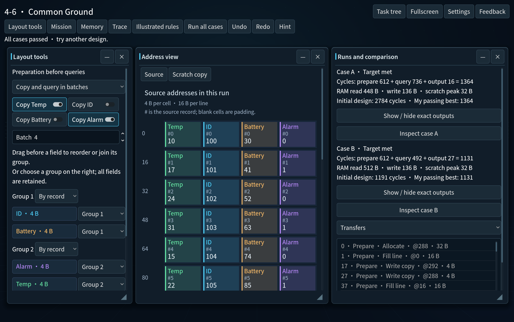
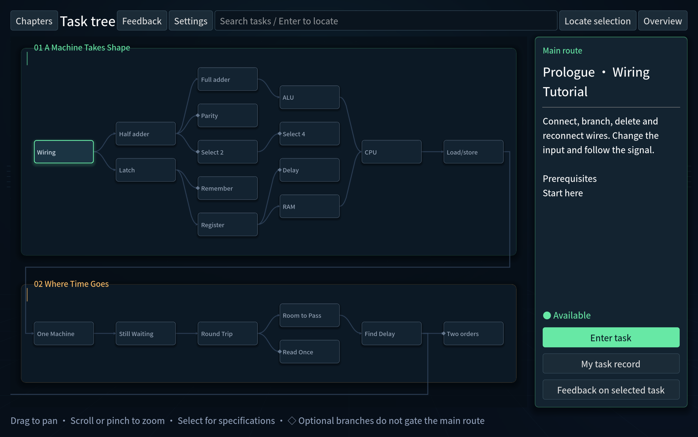
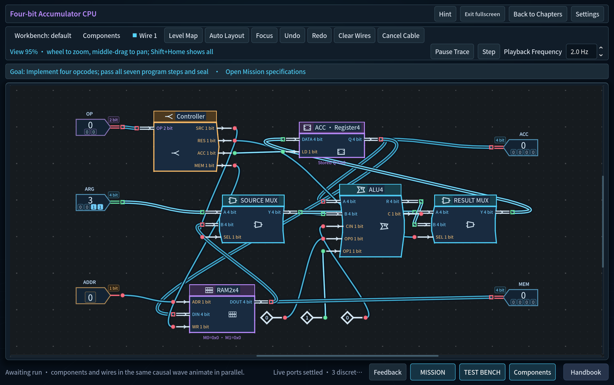
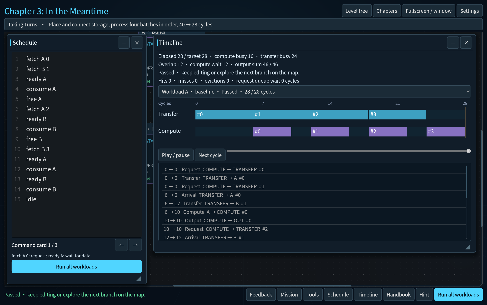
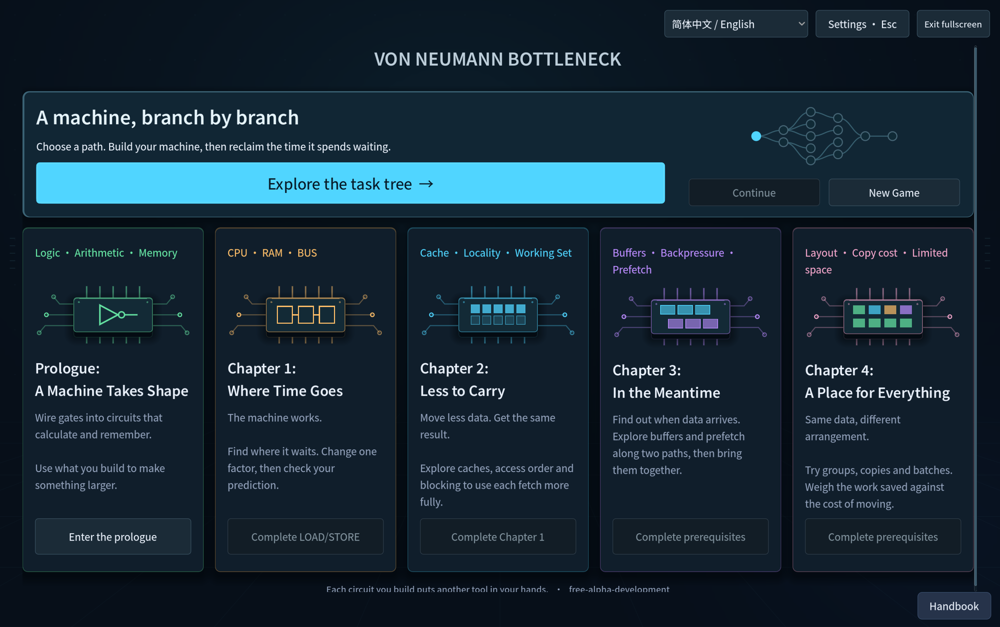

# Von Neumann Bottleneck

[简体中文](README.md) · **English**

**Build a machine from a single wire. Then reclaim the time it spends waiting.**

A construction and optimization puzzle about computers and the data they move. Start with logic gates and registers, build a small computer, then explore caches, buffering, prefetching and memory layout. Wire it up, watch it run, compare the results and find your own solution.

**Current Windows playtest: all 60 task entrances · Offline · Screenshot and scene feedback · Chinese and English**

**[⬇️ Download the Windows offline Pre-release](https://github.com/wizardpc-com/von-neumann-bottleneck/releases/tag/v0.5.0-alpha.3-offline.1)** · [Earlier Windows/macOS Alpha1](https://github.com/wizardpc-com/von-neumann-bottleneck/releases/tag/v0.5.0-alpha.1) · [All releases](https://github.com/wizardpc-com/von-neumann-bottleneck/releases)

**Topics:** computer architecture · data movement · cache and locality · buffering and prefetching · memory layout · educational puzzle



*Common Ground, Chapter 4: the same data serves two workloads. Arrange it, batch it, and compare the real cost of moving it. [Capture provenance and metrics](docs/images/readme/layout-manifest.json).*

**Earlier Alpha (2026-09-18):** `v0.5.0-alpha.1` contains five regions, 40 tasks, and Windows / macOS builds. The latest offline Windows playtest is `v0.5.0-alpha.3-offline.1`; no updated Mac package is included in this round.

**Current source (2026-10-18):** PR #10 has merged into `main` (`bf8f616`). The journey retains40 original tasks, five Representation, three Service, three optional address Prediction and nine compression → content prediction → creation tasks:60 in all. The candidate adds bilingual task context, interactive rules, an earned-record journal, an optional3D observatory, replaceable introduction media and retrospectives, and read-only access to original saved works. Ordinary progression and all-entrance testing have separate save profiles; access grants no completion. The frozen Windows pair is not publicly released; the download above remains the October17 offline playtest. No updated Mac package or public receiver is included. [Current packages and change evidence](docs/verification/20261018-creative-framework/README.md) · [Next-day playtest and handoff](docs/development/night-handoff-20261018.md) · [Current status and limits](docs/CURRENT_STATE.md).

[Download playtest](https://github.com/wizardpc-com/von-neumann-bottleneck/releases/tag/v0.5.0-alpha.3-offline.1) · [What's changed](CHANGELOG.md#english) · [Current build and verification](docs/CURRENT_STATE.md) · [Getting started](#getting-started) · [Report an issue](https://github.com/wizardpc-com/von-neumann-bottleneck/issues)

The earlier fixed7c night candidate's engineering handoff includes its Windows packages and scoped native wiring/restart observations; see the [historical7c record](docs/verification/20261018-night-experience/README.md). Newcomer understanding, final art/narrative judgement and broader platform acceptance remain open.

**Offline teammate Windows candidate:** fixed source `4df5bad46751` opens all60
task entrances. F8 or the persistent feedback button saves a game screenshot,
live design/run context and autosaved notes. After multiple plays and restarts,
send one final ZIP for private consolidated review. Separate tester saves; no
account or network. [Tester guide](distribution/OFFLINE-PLAYTEST-README.txt) ·
[Maintainer import](distribution/OFFLINE-MAINTAINER.txt) ·
[Identity and acceptance](docs/verification/20261017-offline-teammate/README.md).

## What you do

- **Build your own machine.** Choose parts, place and wire them freely, branch from an existing wire, delete, undo and save named designs.
- **Follow the branches.** Arithmetic and memory lead toward a CPU; optional applications give familiar tools new uses. Optional branches do not add gates to the original main route. Continue locates your most recently visited task.
- **Account for the waiting.** Try individual inputs, run the complete tests, then inspect computation, transfers and waiting in the playback, timeline and profiler.
- **Do the same work with less delay.** Change access order, reuse, scheduling or layout. A correct solution can be the starting point for a more efficient one.
- **Learn when you need to.** Reopen the task specification at any time and explore a gradually unlocked illustrated handbook. Hints use a separate read-only canvas, with individual confirmation for the deeper two stages.



*These screenshots come from the actual game during the published Alpha phase; they do not depict the current full-journey interface. The hub and task tree use an isolated fresh profile; the level showcases use designs from a separate QA save. [Image provenance and verification scope](docs/images/readme/README.md)*

## Two different kinds of puzzle

### Make the parts work together

The prologue's **Four-bit Accumulator CPU** brings the arithmetic and memory branches together. Wire the modules you built into a small machine that loads, adds, stores and retrieves values. The internal wiring is yours to design; the values after each instruction reveal whether the whole machine works.



### Put the waiting time to work

In Chapter 3's **Taking Turns**, the next batch can arrive while the current one is being processed. Place buffers, connect their data and status signals, then coordinate the work. Extra parts alone won't do it: filling, using and releasing each buffer must happen at the right time. The timeline shows where you have removed waiting.



## The published Alpha's five regions



| Region | What you explore |
| --- | --- |
| Prologue · **A Machine Takes Shape** | Build arithmetic and memory from gates, then bring your own components together in a CPU. |
| Chapter 1 · **Where Time Goes** | Connect CPU, Bus and RAM; separate computation from waiting and test your diagnosis. |
| Chapter 2 · **Less to Carry** | Explore caches, locality, working sets and blocking to get more use from each fetch. |
| Chapter 3 · **In the Meantime** | Coordinate buffering, backpressure and prefetching so transfers and computation can overlap. |
| Chapter 4 · **A Place for Everything** | Arrange fields, groups and batches while accounting for real copy costs, traffic and limited scratch space. |

The game uses deterministic, deliberately simplified models. Ordinary wires add no latency; waiting and bandwidth belong to modeled components such as Bus, RAM and Cache. Playback speed never changes the result.

See the [maintenance guide](docs/development/final-maintenance.md) for extending tasks, replacing artwork and configuring a feedback receiver.

## Getting started

**Latest Windows playtest:** open the [offline Pre-release](https://github.com/wizardpc-com/von-neumann-bottleneck/releases/tag/v0.5.0-alpha.3-offline.1), download and fully extract the ZIP, then run `Windows/Von-Neumann-Bottleneck.exe`. Mac users can use [earlier Alpha1](https://github.com/wizardpc-com/von-neumann-bottleneck/releases/tag/v0.5.0-alpha.1), which does not include this offline feedback system.

[Your first Alpha session](docs/distribution/astra-challenge/quickstart.en.md) · [September 2026 challenge preparation (archive)](docs/distribution/astra-challenge/README.md)

### Run from source

Install **Godot 4.7.1 stable**, make its executable available as `godot` on your `PATH`, then run:

```sh
git clone https://github.com/wizardpc-com/von-neumann-bottleneck.git
cd von-neumann-bottleneck
godot --editor --path . --import
godot --path .
```

Alternatively, import `project.godot` in the Godot editor, wait for resource import and use **Run Project / F5**. Choose **Explore the task tree** and begin with Wiring Tutorial.

The default interface language is Simplified Chinese. Select English using the bilingual language menu at the **top of the home screen**, or in **Settings → Language**; your choice is saved. You can also choose it at launch:

```sh
godot --path . -- --locale=en
```

### Public Alpha and platforms

The latest public Windows playtest is [offline Pre-release v0.5.0-alpha.3-offline.1](https://github.com/wizardpc-com/von-neumann-bottleneck/releases/tag/v0.5.0-alpha.3-offline.1), fixed source `4df5bad46751`, with build identity and hashes. The earlier online draft remains unpublished. [Earlier Alpha1](https://github.com/wizardpc-com/von-neumann-bottleneck/releases/tag/v0.5.0-alpha.1) retains its matching Windows/Mac packages.

Extract the Mac ZIP and open the `.app`, or extract the Windows ZIP and run the `.exe`; Godot is not required. The macOS build is ad-hoc signed and not notarized. The Windows build is published, but native Windows validation is still more limited. Alpha-stage platform compatibility issues may remain, so bug reports are welcome on GitHub Issues.

To build Mac and Windows candidates from one commit, follow the [candidate build guide](docs/distribution/free-alpha.md). Each frozen commit receives its own build identity.

### Useful controls

| Action | How |
| --- | --- |
| Find a task | Pan, zoom or search the task tree; select a node to read its specification. |
| Place a component | Drag it from the open component tray, or click to place repeated copies. |
| Cancel an operation | Right-click or Esc. |
| Undo / redo | Mac: ⌘Z / ⇧⌘Z. Windows: Ctrl+Z / Ctrl+Y. Text fields handle text edits first. |
| Toggle fullscreen | F11 / Alt+Enter, or the onscreen fullscreen button. |
| Leave task feedback | F8 or Feedback; unfinished tasks can also receive ratings and comments. |

Mac also supports **⌘,** for Settings and **⌃⌘F** for fullscreen. Drag a tool, Settings or Handbook by its title. Window positions are kept inside the available view.

## Saves, settings and feedback

Progress and named designs stay on your computer. Back up the entire save directory before updating or reverting; do not erase player data to prepare a test. See the [package instructions](distribution/PLAYTEST-README.txt) for locations and compatibility notes.

Settings include language, sound volume, display controls, reduced motion and local diagnostics. Neither the published Alpha nor the frozen full-journey candidate packages have a remote feedback receiver configured; feedback can stay on your computer. Statistics, written feedback and experimental scores have separate sharing controls. Declining uploads does not restrict the game. Your personal task board works offline and shows total and regional completion.

To report a bug, open a [GitHub Issue](https://github.com/wizardpc-com/von-neumann-bottleneck/issues) with the build ID, operating system, task and steps to reproduce it. Exporting feedback in the game does not automatically post it to GitHub; you decide whether to share the file.

## Development and documentation

- [Current state](docs/CURRENT_STATE.md) · [Release acceptance gates](RELEASE_BLOCKERS.md)
- [Bilingual changelog](CHANGELOG.md) · [Documentation index](docs/README.md)
- [Architecture](ARCHITECTURE.md) · [Simulation models](docs/architecture/simulation.md) · [Content and save contracts](docs/architecture/content-system.md)
- [Mac handoff](docs/development/mac-handoff.md) · [Isolated verification](docs/development/testing.md) · [Candidate builds](docs/distribution/free-alpha.md)
- [Feedback and privacy](docs/architecture/community-feedback.md) · [Future deployment checklist](docs/distribution/community-deployment-checklist.md)

Code is available under the [MIT License](LICENSE). The bundled font is [Noto Sans SC / SIL OFL 1.1](assets/fonts/OFL-NotoSansSC.txt). Interface graphics are drawn by project code.
