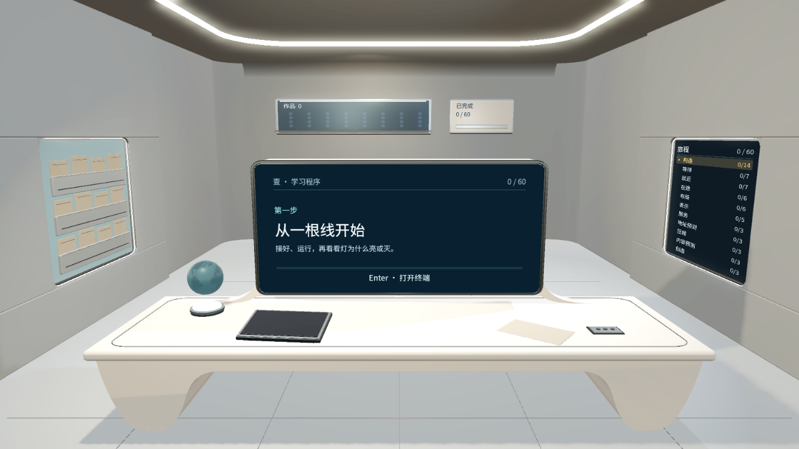
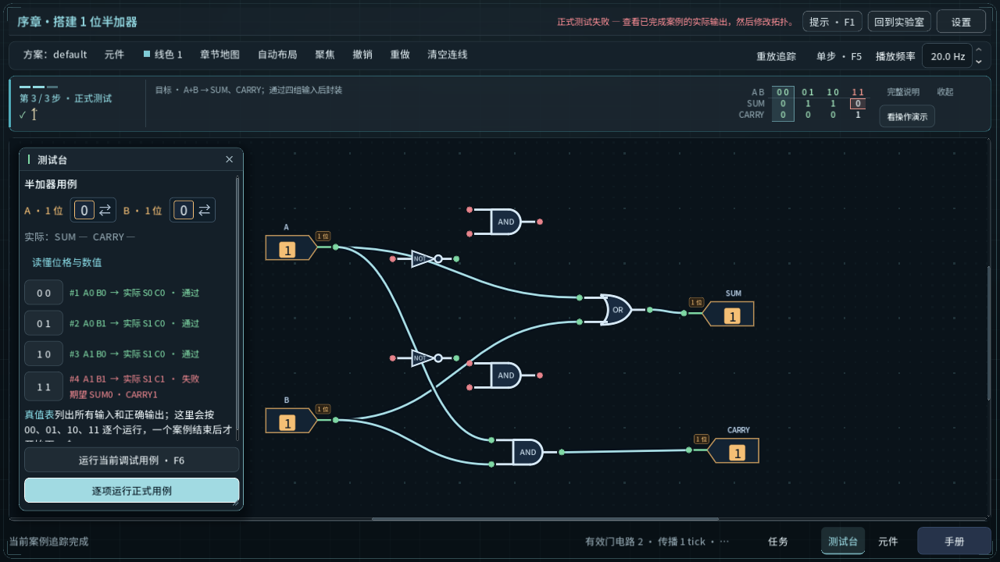
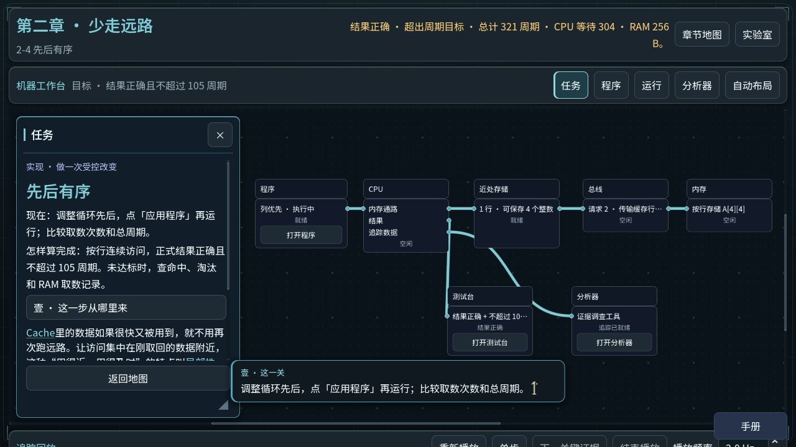
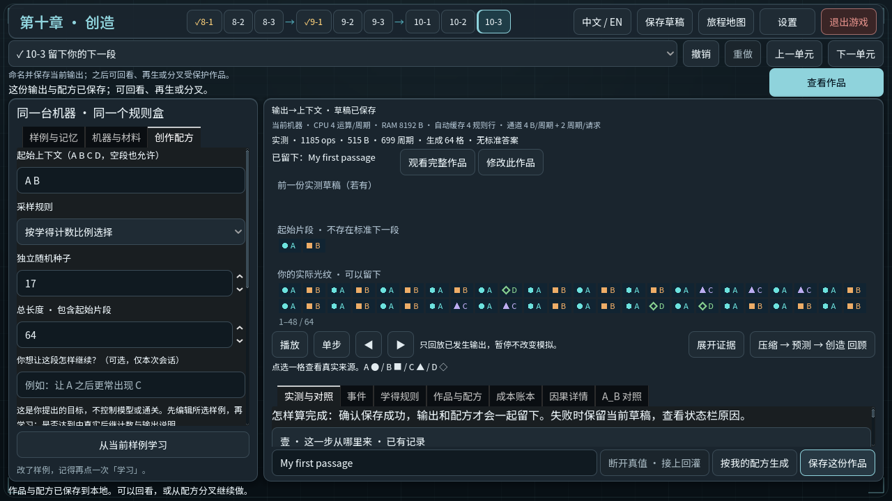

# Von Neumann Bottleneck

[简体中文](README.md) · **English**

**Build a machine from a single wire. Then reclaim the time it spends waiting.**

A construction and optimization puzzle about computers and the data they move. Start with logic gates and registers, build a small computer, then explore caches, buffering, prefetching and memory layout. Wire it up, watch it run, compare the results and find your own solution.

**Laboratory journey · 60 tasks · Chinese and English**

**Latest public playtest:** [v0.6.1-playtest.2](https://github.com/wizardpc-com/von-neumann-bottleneck/releases/tag/v0.6.1-playtest.2) ships Game and Test for Windows x64 and macOS Universal. Choose **Game** for normal progression. Both editions work offline and make sharing optional. **Test** keeps its own saves and can export offline incident captures. [Checksums and verification](docs/verification/20261122-final-playtest/README.md) · [Playtest.1 evidence](docs/verification/20261122-public-release/README.md).

**Historical builds:** [v0.5.0-alpha.4](https://github.com/wizardpc-com/von-neumann-bottleneck/releases/tag/v0.5.0-alpha.4) was the October 24 offline playtest. Earlier downloads include the [October 17 offline Windows build](https://github.com/wizardpc-com/von-neumann-bottleneck/releases/tag/v0.5.0-alpha.3-offline.1) and [Alpha1](https://github.com/wizardpc-com/von-neumann-bottleneck/releases/tag/v0.5.0-alpha.1). The [November 16 v0.6.0 delivery](docs/verification/20261116-final-product/README.md) has its own verification record.

**[⬇️ Download the Windows / macOS playtest](https://github.com/wizardpc-com/von-neumann-bottleneck/releases/tag/v0.6.1-playtest.2)** · [All releases](https://github.com/wizardpc-com/von-neumann-bottleneck/releases)

**Topics:** computer architecture · data movement · cache and locality · buffering and prefetching · memory layout · educational puzzle



*All four images show the Chinese UI, recorded during development on October 21–23, 2026 with isolated saves and unchanged pixels. They are not fresh Alpha4 binary captures or a complete newcomer playthrough. [Image sources and scope](docs/images/player-guide/README.md).*

**Earlier Alpha (2026-09-18):** `v0.5.0-alpha.1` contains five regions, 40 tasks, and Windows / macOS builds. The historical October 17 Windows build is `v0.5.0-alpha.3-offline.1`.

**Historical journey candidate (2026-10-18):** PR #10 is merged into `main` (`bf8f616`). Product source `5bd3792b022e` on `codex/journey-final-candidate-20261018` retains all60 tasks, bilingual context, interactive rules, the earned-record journal, optional3D observatory and read-only original-work review. Chapter2 now shows the actual run's cycles, target margin and fetch-evidence entry; the first earned result has a replaceable temporary scene image. Ordinary progression and all-entrance testing use separate profiles; access grants no completion. This historical Windows pair was not independently published. [New packages, change images and verification scope](docs/verification/20261018-journey-final/README.md) · [Next-day playtest and handoff](docs/development/night-handoff-20261018.md) · [Current status](docs/CURRENT_STATE.md).

[Download playtest](https://github.com/wizardpc-com/von-neumann-bottleneck/releases/tag/v0.6.1-playtest.2) · [What's changed](CHANGELOG.md#english) · [Current build and verification](docs/CURRENT_STATE.md) · [Getting started](#getting-started) · [Report an issue](https://github.com/wizardpc-com/von-neumann-bottleneck/issues)

The earlier fixed7c night candidate's engineering handoff includes its Windows packages and scoped native wiring/restart observations; see the [historical7c record](docs/verification/20261018-night-experience/README.md). Newcomer understanding, final art/narrative judgement and broader platform acceptance remain open.

**Historical public offline build (2026-10-17):** fixed source `4df5bad46751` opens all60
task entrances. F8 or the persistent feedback button saves a game screenshot,
live design/run context and autosaved notes. After multiple plays and restarts,
send one final ZIP for private consolidated review. Separate tester saves; no
account or network. [Tester guide](distribution/OFFLINE-PLAYTEST-README.txt) ·
[Maintainer import](distribution/OFFLINE-MAINTAINER.txt) ·
[Identity and acceptance](docs/verification/20261017-offline-teammate/README.md).

## What you do

- **Build your own machine.** Choose parts, place and wire them freely, branch from an existing wire, delete, undo and save named designs.
- **Follow the branches.** Arithmetic and memory lead toward a CPU; optional applications give familiar tools new uses. Optional branches do not add gates to the original main route. Continue locates your most recently visited task.
- **Account for the waiting.** Try individual inputs, run the complete tests, then inspect computation, transfers and waiting in the playback, timeline and profiler.
- **Do the same work with less delay.** Change access order, reuse, scheduling or layout. A correct solution can be the starting point for a more efficient one.
- **Learn when you need to.** Reopen the task specification at any time and explore a gradually unlocked illustrated handbook. Hints use a separate read-only canvas, with individual confirmation for the deeper two stages.

## Build, improve and create

### Make the parts work together

Start with a half-adder and run the complete test over all four inputs. In this example, A=B=1 produces SUM=1 where the specification requires SUM=0. Compare the actual and expected outputs, then revise the wiring. Passing every official case lets you seal the circuit as a **HalfAdder** and reuse it in the full-adder and later tasks.



The arithmetic and memory branches meet in the **Four-bit Accumulator CPU**. Wire the modules you built into a small machine that loads, adds, stores and retrieves values. The internal wiring is yours to design; the values after each instruction reveal whether the whole machine works.

### Put the waiting time to work

Correct output can still spend too much time waiting. This Chapter 2 access-order example takes **321 cycles** with column-first traversal, exceeding the **105-cycle task target**. Change the loop order, apply the program and rerun, then compare fetches, cache hits and total cycles.



Later, coordinate buffering, backpressure and prefetching so the next batch arrives during computation, or change field layout and batching to compare traffic, copy costs and scratch space. The timeline and profiler help you check whether an edit actually works.

### Keep something you made

The later light-pattern workbench connects compression, content prediction and creation. Learn rules from examples, choose an initial passage and generation settings, then save the actual output with its recipe. Revisit saved works on the laboratory wall or continue exploring from their recipes.



## The complete sixty-task journey

| Region | What you explore |
| --- | --- |
| Prologue · **A Machine Takes Shape** | Build arithmetic and memory from gates, then bring your own components together in a CPU. |
| Chapter 1 · **Where Time Goes** | Connect CPU, Bus and RAM; separate computation from waiting and test your diagnosis. |
| Chapter 2 · **Less to Carry** | Explore caches, locality, working sets and blocking to get more use from each fetch. |
| Chapter 3 · **In the Meantime** | Coordinate buffering, backpressure and prefetching so transfers and computation can overlap. |
| Chapter 4 · **A Place for Everything** | Arrange fields, groups and batches while accounting for real copy costs, traffic and limited scratch space. |
| Chapter 5 · **Representation** (5 tasks) | Choose data representations and compare scans, hotspots and preparation costs. |
| Chapter 6 · **Service** (3 tasks) | Arrange state, requests and a shared service plan; compare transfers and response. |
| Chapter 7 · **Address prediction** (3 tasks) | Reveal requests, build rules from limited history and measure their costs. |
| Chapters 8–10 · **Compression, content prediction and creation** (9 tasks) | Learn finite rules, test lossless restoration and prediction, then generate and save your own light patterns. |

The prologue through Chapter 4 contain the core 40 tasks. Representation adds 5, Service 3, address Prediction 3, and compression/content prediction/creation 9, for 60 total. They are not sixty mandatory steps: optional content does not raise the original mainline prerequisites.

The game uses deterministic, deliberately simplified models. Ordinary wires add no latency; waiting and bandwidth belong to modeled components such as Bus, RAM and Cache. Playback speed never changes the result.

See the [maintenance guide](docs/development/final-maintenance.md) for extending tasks, replacing artwork and configuring a feedback receiver.

## Getting started

**Windows / macOS:** Open [v0.6.1-playtest.2](https://github.com/wizardpc-com/von-neumann-bottleneck/releases/tag/v0.6.1-playtest.2), download the **Game** ZIP for your platform and extract it in full. Run the included `.exe` on Windows or open the `.app` on Mac. Godot is bundled. Choose the separate **Test** ZIP for task access and offline capture.

[Claude development handoff and unmet requirements](docs/development/CLAUDE_HANDOFF_20261018.md)

### Run from source

**Source launch:** the root `project.godot` / F5 opens the laboratory and full 60-task journey with ordinary progression. Use `--core-journey`, `--classic-hub` or `--classic-tutorial` for the retained earlier surfaces. Source play uses ordinary saves; use the packaged tester for all entrances and a separate profile. [Current team handoff](docs/development/team-handoff.md).


Install **Godot 4.7.1 stable**, make its executable available as `godot` on your `PATH`, then run:

```sh
git clone https://github.com/wizardpc-com/von-neumann-bottleneck.git
cd von-neumann-bottleneck
godot --editor --path . --import
godot --path .
```

Alternatively, import `project.godot` in the Godot editor, wait for resource import and use **Run Project / F5**. Click the laboratory terminal or press Enter, then begin with Wiring Tutorial. The terminal's Journey action and right-wall journey board open the task map.

Four cinematics accompany first launch, the official final LOAD/STORE pass in the prologue, all five officially accepted Representation plans, and a successful saved work in task 10-3. Each supports Esc/Skip; viewing history is stored separately and survives New Game.

The downloaded Game and Test packages each lock their edition. Open the other package to switch editions. In a source launch, the laboratory terminal can switch modes. Game keeps earned progression and Test provides separate task access.

The default interface language is Simplified Chinese. Use **EN / 中文 in the awakened terminal's title bar**, or **Settings → Language**; your choice is saved. You can also choose it at launch:

```sh
godot --path . -- --locale=en
```

### Public playtest and platforms

The [current public playtest release](https://github.com/wizardpc-com/von-neumann-bottleneck/releases/tag/v0.6.1-playtest.2) includes four ZIPs and `SHA256SUMS.txt`. Game and Test keep separate saves. The [Alpha4 release](https://github.com/wizardpc-com/von-neumann-bottleneck/releases/tag/v0.5.0-alpha.4) remains available for players using its historical CloudPlaytest profile. [Current release verification and limits](docs/verification/20261122-final-playtest/README.md).

See the [release evidence](docs/verification/20261122-final-playtest/README.md) for signing status, native startup results, and platform limits.

To build Mac and Windows candidates from one commit, follow the [candidate build guide](docs/distribution/free-alpha.md). Each frozen commit receives its own build identity.

### Useful controls

| Action | How |
| --- | --- |
| Find a task | Pan, zoom or search the task tree; select a node to read its specification. |
| Place a component | Drag it from the open component tray, or click to place repeated copies. |
| Cancel an operation | Right-click or Esc. |
| Undo / redo | Mac: ⌘Z / ⇧⌘Z. Windows: Ctrl+Z / Ctrl+Y. Text fields handle text edits first. |
| Toggle fullscreen | F11 / Alt+Enter, or the onscreen fullscreen button. |
| Leave task feedback | F8 or Feedback; unfinished tasks can also receive ratings and comments. |

Mac also supports **⌘,** for Settings and **⌃⌘F** for fullscreen. Drag a tool, Settings or Handbook by its title. Window positions are kept inside the available view.

## Saves, settings and feedback

Progress and named designs stay on your computer. Back up the entire save directory before updating or reverting; do not erase player data to prepare a test. See the [package instructions](distribution/PLAYTEST-README.txt) for locations and compatibility notes.

Settings include language, sound volume, display controls, reduced motion and local diagnostics. At first launch, choose **Accept service** or **Decline service**. **View details** opens the privacy notice. Declining still lets you play offline and send individual opinions. After accepting, the first acknowledged upload enables **Feedback → View my results**. The game provides no link before then. The private page refreshes every 15 seconds while visible. Test can keep its captures and ZIPs locally.

To report a bug, open a [GitHub Issue](https://github.com/wizardpc-com/von-neumann-bottleneck/issues) with the build ID, operating system, task and steps to reproduce it. Exporting feedback in the game does not automatically post it to GitHub; you decide whether to share the file.

## Development and documentation

- [Current state](docs/CURRENT_STATE.md) · [Release acceptance gates](RELEASE_BLOCKERS.md)
- [Bilingual changelog](CHANGELOG.md) · [Documentation index](docs/README.md)
- [Architecture](ARCHITECTURE.md) · [Simulation models](docs/architecture/simulation.md) · [Content and save contracts](docs/architecture/content-system.md)
- [Mac handoff](docs/development/mac-handoff.md) · [Isolated verification](docs/development/testing.md) · [Candidate builds](docs/distribution/free-alpha.md)
- [Feedback and privacy](docs/architecture/community-feedback.md) · [Future deployment checklist](docs/distribution/community-deployment-checklist.md)

Code is available under the [MIT License](LICENSE). The bundled font is [Noto Sans SC / SIL OFL 1.1](assets/fonts/OFL-NotoSansSC.txt). Interface graphics are drawn by project code.
