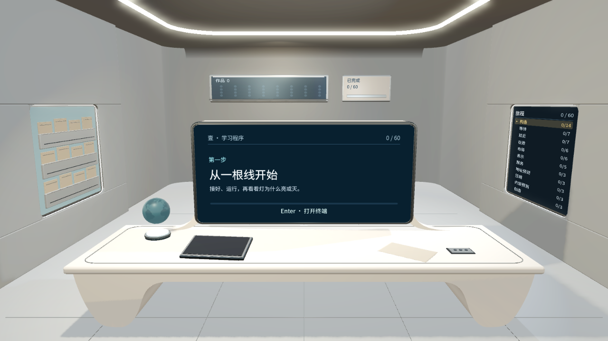
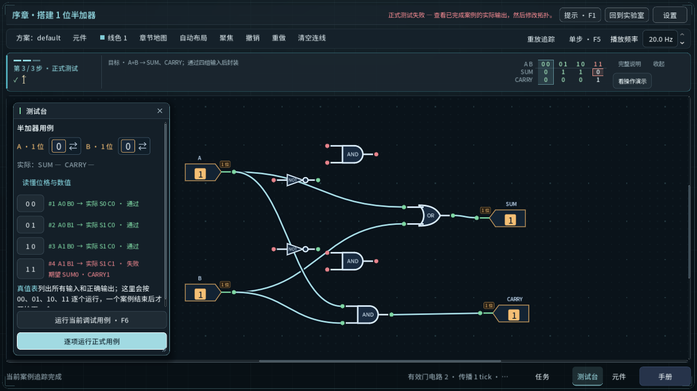
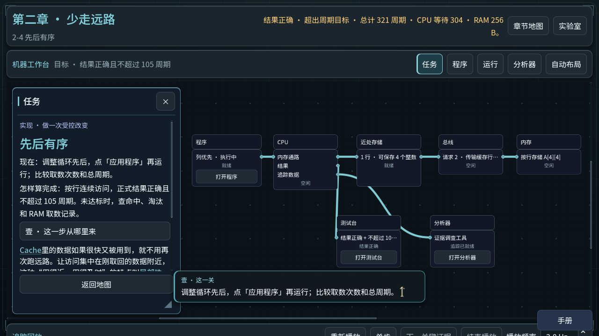
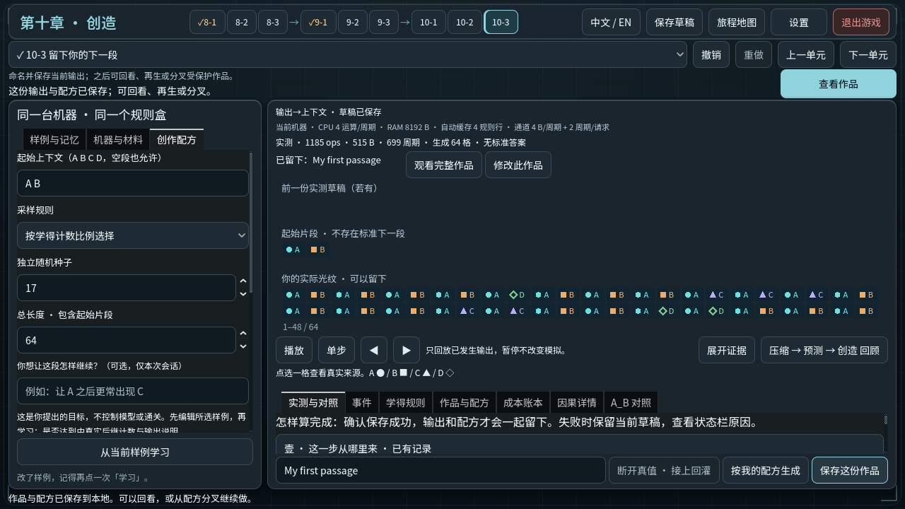

# 冯·诺依曼瓶颈

**简体中文** · [English](README.en.md)

**从一根线搭起机器，再找回它等待数据的时间。**

一款关于计算机与数据流的构建解谜游戏。从逻辑门、寄存器到自己的小计算机，再探索缓存、缓冲、预取与数据布局。接出电路，观察运行，比较结果，寻找自己的解法。

**当前源码：实验室旅程 · 60 项任务 · 完全离线反馈 · 中英文界面**

**最新公开试玩（2026-10-24）：** [v0.5.0-alpha.4](https://github.com/wizardpc-com/von-neumann-bottleneck/releases/tag/v0.5.0-alpha.4) 提供 **Windows x86_64 / macOS 通用版（Intel、Apple Silicon）**，完整60项旅程，无需安装Godot、账号或联网。实验室、手册、四段演出与近期恢复/双语界面修复均已包含；默认Game，Test成果隔离。Windows实包定向验证已通过；Mac已完成结构与哈希检查，尚未实机验收。比赛提交包单独冻结。[当前版本与核验](docs/verification/20261024-desktop-release/README.md)。

**[⬇️ 下载 Windows / macOS 离线试玩](https://github.com/wizardpc-com/von-neumann-bottleneck/releases/tag/v0.5.0-alpha.4)** · [历史Windows离线版（2026-10-17）](https://github.com/wizardpc-com/von-neumann-bottleneck/releases/tag/v0.5.0-alpha.3-offline.1) · [旧版 Windows/macOS Alpha1](https://github.com/wizardpc-com/von-neumann-bottleneck/releases/tag/v0.5.0-alpha.1) · [全部 Releases](https://github.com/wizardpc-com/von-neumann-bottleneck/releases)

**关键词：** 计算机体系结构 · 数据搬运 · 缓存与局部性 · 缓冲与预取 · 内存布局 · 教育解谜



*本文四幅配图来自 2026 年 10 月 21–23 日使用隔离存档的开发实机记录，保留原始像素；不是 Alpha4 二进制重新截图，也不是新玩家完整通关记录。[配图来源与范围](docs/images/player-guide/README.md)。*

**旧版 Alpha（2026-09-18）：** `v0.5.0-alpha.1` 包含五个区域、40 个任务以及 Windows / macOS 构建。10月17日历史离线版为 `v0.5.0-alpha.3-offline.1`；当前双平台包见上方 `v0.5.0-alpha.4`。

**历史旅程候选（2026-10-18）：** PR #10 已合并至 `main`（`bf8f616`）。当时独立分支 `codex/journey-final-candidate-20261018` 的产品固定于 `5bd3792b022e`：60 项任务、双语语境、互动规则、成长档案、可选 3D 观察站和只读原作品回顾；第二章呈现同次实际周期、目标差值及取数证据入口，首次成果接入可替换的临时场景图。普通进度与全关测试采用独立存档，测试访问不授予成果。本轮 Windows 双包未公开发布；该历史候选未独立公开发布，当前双平台下载见上方Alpha4。[新版包、变化截图与验证范围](docs/verification/20261018-journey-final/README.md) · [次日试玩与交接](docs/development/night-handoff-20261018.md) · [当前状态](docs/CURRENT_STATE.md)。

[下载试玩](https://github.com/wizardpc-com/von-neumann-bottleneck/releases/tag/v0.5.0-alpha.4) · [更新说明](CHANGELOG.md#简体中文) · [当前版本与验证记录](docs/CURRENT_STATE.md) · [运行方法](#开始游玩) · [问题反馈](https://github.com/wizardpc-com/von-neumann-bottleneck/issues)

早期固定7c夜间候选的工程交接已完成，包括其Windows实包与限定原生接线／重启观察；该历史范围见[7c验收记录](docs/verification/20261018-night-experience/README.md)。真人理解、最终美术／叙事与更广平台验收仍开放。

**历史公开离线试玩（2026-10-17，Windows）：** 固定源码 `4df5bad46751` 开放全部60个任务入口；随时按 F8 或点“现场反馈”，自动保留游戏截图、当前方案与运行现场，文字自动保存。多次退出重启后，最后导出一个 ZIP 即可交给维护者集中查看。独立测试存档，无需账号或网络。[试玩说明](distribution/OFFLINE-PLAYTEST-README.txt) · [集中导入与分析](distribution/OFFLINE-MAINTAINER.txt) · [固定版本与验收](docs/verification/20261017-offline-teammate/README.md)。

## 在这里做什么

- **搭建自己的机器。** 从元件台选件，自由放置、接线、在线段中间分支；可以删除、撤销，并保存命名方案。
- **沿着任务树探索。** 算术与存储分支汇入 CPU，应用支线提供新的用途。可选支线不增加原主线门槛，“继续游戏”会定位最近游玩的任务。
- **看清每一次等待。** 调试输入、运行完整测试，再用回放、时间线和分析器查看计算、搬运与等待。
- **让相同的工作少花时间。** 改变访问顺序、复用方式、调度或布局；结果正确还不够，也可以继续寻找更省搬运的方案。
- **按需学习。** 任务规格随时可看，图解手册逐步开放；Hint 在独立只读画布中逐层揭示，后两级分别确认。

## 搭建、改进与创造

### 把零件接成一台机器

先搭一个半加器，用完整测试检查四种输入。图中的方案在 A=B=1 时得到 SUM=1，而规格要求 SUM=0；查看实际与期望的差别，再回到线路修改。全部正式用例通过后，把电路封装成 **HalfAdder**，在全加器等后续任务中复用。



算术与存储两条路线最终汇入**四位累加器 CPU**：将自己做出的运算、寄存器和内存模块接在一起，让它读数、相加、保存，再取回结果。内部怎样布线由你决定；每一步的数值会检验这台小机器是否真的按指令工作。

### 让等待的时间也派上用场

结果正确，也可能把时间花在等待上。第二章的访问顺序任务中，图示列优先方案用了 **321 周期**，超过 **105 周期的任务目标**。调整循环先后，应用程序再运行，比较取数次数、缓存命中和总周期，找出哪些数据值得留在近处。



之后还可以安排缓冲、反压与预取，让下一批数据在这一批计算时赶到；或改变字段布局和分批方式，比较流量、复制成本与空间占用。时间线和分析器帮助你检查改动是否有效。

### 留下自己的作品

后期光纹工作台沿着压缩、内容预测走向创造：从样例学习规则，选择起始片段与生成方式，再保存自己的输出和配方。保存后的作品可在实验室作品墙回看，也可从配方继续探索。



## 完整 60 项旅程

| 区域 | 你会探索什么 |
| --- | --- |
| 序章 · **一线成机** | 从逻辑门构建运算和存储，将自己的成果组合成 CPU。 |
| 第一章 · **时间的去处** | 连接 CPU、Bus 与 RAM，分辨计算与等待，验证瓶颈判断。 |
| 第二章 · **少走远路** | 研究缓存、局部性、工作集和分块，让取回的数据多用几次。 |
| 第三章 · **与等待并行** | 安排缓冲、反压与预取，让数据搬运和计算配合起来。 |
| 第四章 · **各就其位** | 组合字段、排列和分批，权衡真实复制成本、流量与有限空间。 |
| 第五章 · **表示**（5 项） | 选择数据的表示方式，比较扫描、热点与预处理的代价。 |
| 第六章 · **服务**（3 项） | 安排状态、请求与同一服务方案，比较搬运和响应。 |
| 第七章 · **地址预测**（3 项） | 逐步观察请求，以有限历史构造预测规则并检验代价。 |
| 第八至十章 · **压缩、内容预测与创造**（9 项） | 学习有限规则，检验无损复原和预测，再生成、保存自己的光纹作品。 |

序章至第四章为核心 40 项，加上表示 5、服务 3、地址预测 3、压缩／内容预测／创造 9，共 60 项。完整旅程不是 60 个必经关卡；可选内容不增加原主线门槛。

关卡采用确定性的简化模型。普通连线只表示连接，没有额外延迟；等待与带宽来自 Bus、RAM、Cache 等被建模的部件。动画快慢不改变计算结果。

关卡扩展、素材替换与反馈服务配置见[维护指南](docs/development/final-maintenance.md)。

## 开始游玩

**Windows / macOS 离线试玩：** 前往 [v0.5.0-alpha.4](https://github.com/wizardpc-com/von-neumann-bottleneck/releases/tag/v0.5.0-alpha.4)，按平台下载 ZIP 并完整解压。Windows 运行 `Windows/Von-Neumann-Bottleneck.exe`，Mac 运行 `macOS/Von-Neumann-Bottleneck.app`。两个包都包含运行时，无需安装 Godot。

[Claude开发交接与未满足需求](docs/development/CLAUDE_HANDOFF_20261018.md)

### 从源码运行

**源码直接启动即完整旅程（2026-10-19 起）：** 根目录 `project.godot` / F5 默认打开全部 60 项任务（核心 40 + 表示 5 + 服务 3 + 地址预测 3 + 压缩／内容预测／创造 9），首页是实验室，存档写在普通存档目录。需要旧表面时使用用户参数：`--core-journey`（只看核心 40 项）、`--classic-hub`（旧首页）、`--classic-tutorial`（旧教程）。接手说明见 [实验室旅程交接](docs/development/LAB_JOURNEY_HANDOFF_20261019.md)。

安装 **Godot 4.7.1 stable**，将可执行文件加入 `PATH`，然后运行：

```sh
git clone https://github.com/wizardpc-com/von-neumann-bottleneck.git
cd von-neumann-bottleneck
godot --editor --path . --import
godot --path .
```

也可以在 Godot 中导入 `project.godot`，完成资源导入后按 **“运行项目”／F5** 启动整个游戏。首页是实验室：点击终端屏幕（或按 Enter）唤醒终端，按主按钮从接线教程开始；右墙「旅程板」或终端上的「旅程」打开任务树。

四段 CG 分别接在首次启动、序章最终 LOAD/STORE 正式通过、第五章五份表示方案全部正式达标，以及第十章 10-3 成功保存作品之后。均支持 Esc／跳过；观看记录独立保存，重新开始游戏不会重复播放。

唤醒实验室终端后，可在“开始 / 继续”右侧直接选择**游戏模式**或**测试模式**，并查看两种模式的说明。游戏模式按前置推进，保留玩家成果；测试模式可直接查看各关，临时元件与进度隔离，切回游戏模式不会授予测试成果。每次启动默认游戏模式。设置中的模式入口及硬件和第一／二章顶部的选择仍可使用；其他工作台先保存并返回终端再切换。

游戏默认简体中文，可在唤醒后的**终端标题栏**点 EN／中文，也可使用 **设置 → 语言**；选择会保存。也可指定启动语言：

```sh
godot --path . -- --locale=en
```

### 公开 Alpha 与平台

当前公开双平台试玩为 [v0.5.0-alpha.4](https://github.com/wizardpc-com/von-neumann-bottleneck/releases/tag/v0.5.0-alpha.4)，固定源码 `2c4a9d8bdf13`，提供构建清单与SHA256；包内使用稳定的CloudPlaytest隔离存档，与10月17日OfflineTeammate存档分开，不自动迁移。Mac包未公证且尚未完成Mac实机验证。[发布与验收范围](docs/verification/20261024-desktop-release/README.md)。

Mac 解压后打开 `.app`，Windows 解压后运行 `.exe`，无需另外安装 Godot。当前 macOS 构建为 ad-hoc 签名、未公证；Windows 构建已发布，但原生实机验证仍相对有限。Alpha 阶段仍可能存在平台兼容性问题，欢迎通过 GitHub Issues 反馈。

自行生成同一提交的 Mac／Windows 候选包，请使用[统一构建流程](docs/distribution/free-alpha.md)，不要把不同提交的包混用同一个版本号。

### 常用操作

| 操作 | 方法 |
| --- | --- |
| 查找下一关 | 在任务树拖动、缩放、搜索；选择节点查看任务规格。 |
| 放置元件 | 从默认打开的元件台拖到画布，或点击后连续放置。 |
| 取消当前操作 | 右键或 Esc。 |
| 撤销／重做 | Mac：⌘Z／⇧⌘Z；Windows：Ctrl+Z／Ctrl+Y。文本框优先处理文字编辑。 |
| 切换全屏 | Mac：⌃⌘F；也支持 F11／Alt+Enter 或全屏按钮。 |
| 打开设置／移动窗口 | Mac：⌘,；也支持 F10 或设置按钮。拖动仪表、设置或手册的标题栏移动窗口。 |
| 评价当前任务 | F8 或“反馈”；未通关也可以评分、写意见。 |

## 进度、设置与反馈

进度和命名方案保存在本机。更新或回退版本前，请完整备份存档目录；不要通过清档准备试玩。具体位置和兼容性见[随包说明](distribution/PLAYTEST-README.txt)。

设置包含语言、音效音量、显示、减少动效和本地诊断。当前已发布 Alpha 与已冻结的完整旅程候选包均未配置远程反馈入口；反馈可留在本机。自动统计分享、主动意见和实验成绩分别授权，拒绝上传不影响完整游玩。个人任务板可以离线查看总完成数和各区域进度。

发现问题可提交 [GitHub Issue](https://github.com/wizardpc-com/von-neumann-bottleneck/issues)，附上构建编号、系统、任务和复现步骤。游戏内导出不会自动发布到 GitHub，是否分享文件由你决定。

## 开发与文档

- [当前状态](docs/CURRENT_STATE.md) · [发布前待验收项](RELEASE_BLOCKERS.md)
- [中英文更新说明](CHANGELOG.md) · [文档导航](docs/README.md)
- [架构](ARCHITECTURE.md) · [仿真模型](docs/architecture/simulation.md) · [内容与存档约定](docs/architecture/content-system.md)
- [Mac 开发交接](docs/development/mac-handoff.md) · [隔离测试](docs/development/testing.md) · [候选包构建](docs/distribution/free-alpha.md)
- [反馈与隐私设计](docs/architecture/community-feedback.md) · [后续部署清单](docs/distribution/community-deployment-checklist.md)

代码采用 [MIT License](LICENSE)。字体采用 [Noto Sans SC / SIL OFL 1.1](assets/fonts/OFL-NotoSansSC.txt)；界面图形由本项目代码绘制。
