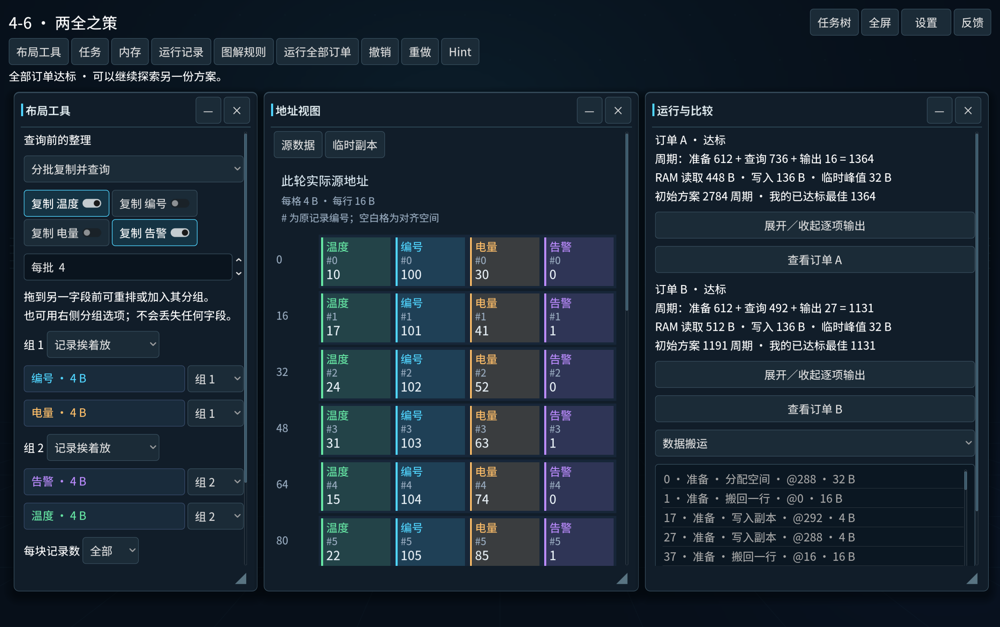
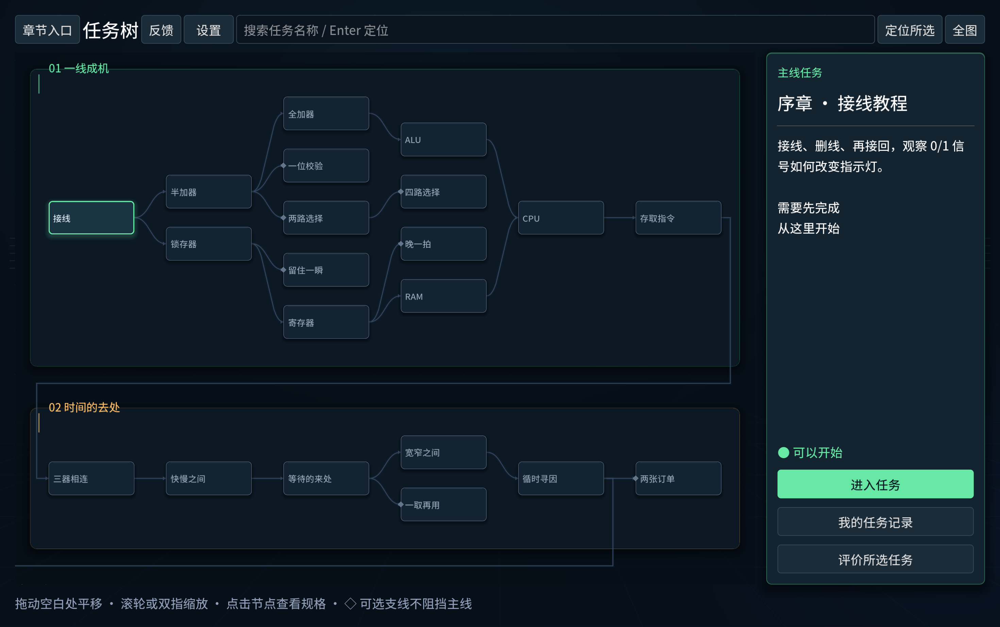
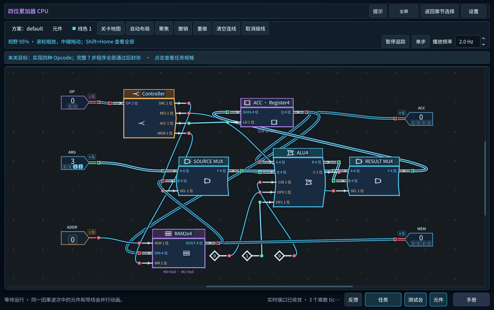
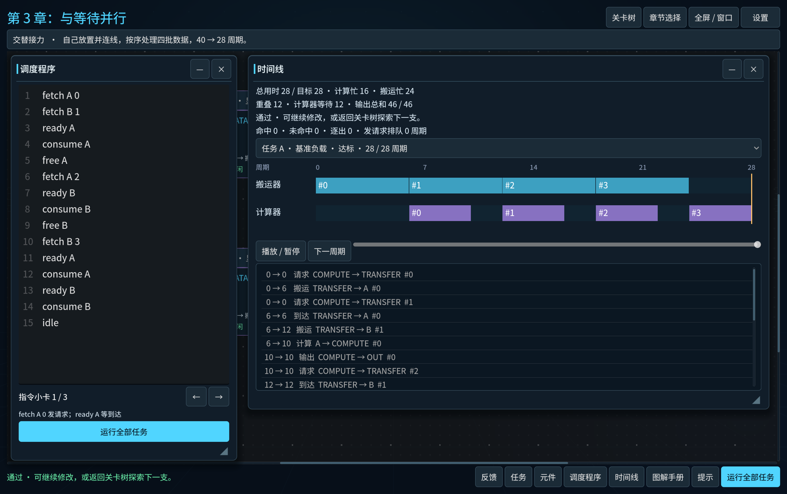
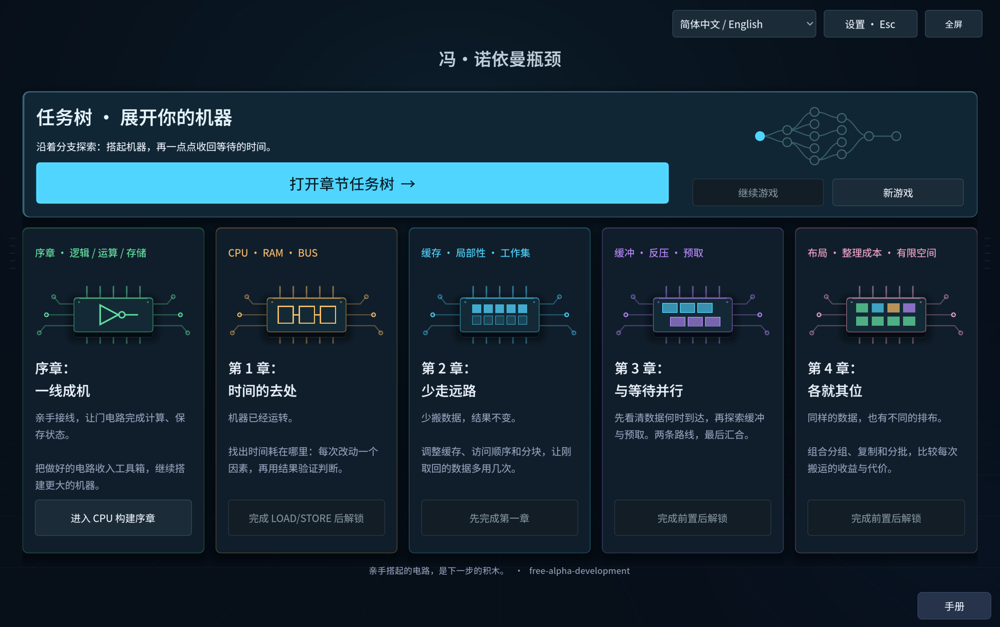

# 冯·诺依曼瓶颈

**简体中文** · [English](README.en.md)

**从一根线搭起机器，再找回它等待数据的时间。**

一款关于计算机与数据流的构建解谜游戏。从逻辑门、寄存器到自己的小计算机，再探索缓存、缓冲、预取与数据布局。接出电路，观察运行，比较结果，寻找自己的解法。

**当前 Windows 试玩：60 个任务全入口 · 完全离线 · 截图与现场反馈 · 中英文界面**

**[⬇️ 下载 Windows 离线试玩 Pre-release](https://github.com/wizardpc-com/von-neumann-bottleneck/releases/tag/v0.5.0-alpha.3-offline.1)** · [旧版 Windows/macOS Alpha1](https://github.com/wizardpc-com/von-neumann-bottleneck/releases/tag/v0.5.0-alpha.1) · [全部 Releases](https://github.com/wizardpc-com/von-neumann-bottleneck/releases)

**关键词：** 计算机体系结构 · 数据搬运 · 缓存与局部性 · 缓冲与预取 · 内存布局 · 教育解谜



*第四章「两全之策」：同一份数据，两种查询需求。调整布局与分批，比较真实搬运成本。[截图来源与运行数值](docs/images/readme/layout-manifest.json)。*

**旧版 Alpha（2026-09-18）：** `v0.5.0-alpha.1` 包含五个区域、40 个任务以及 Windows / macOS 构建。最新 Windows 离线试玩为 `v0.5.0-alpha.3-offline.1`；本轮未提供新版 Mac 包。

**旅程新版候选（2026-10-18）：** PR #10 已合并至 `main`（`bf8f616`）。当前独立分支 `codex/journey-final-candidate-20261018` 的产品固定于 `5bd3792b022e`：60 项任务、双语语境、互动规则、成长档案、可选 3D 观察站和只读原作品回顾；第二章呈现同次实际周期、目标差值及取数证据入口，首次成果接入可替换的临时场景图。普通进度与全关测试采用独立存档，测试访问不授予成果。本轮 Windows 双包未公开发布；上方下载仍是10月17日离线版。[新版包、变化截图与验证范围](docs/verification/20261018-journey-final/README.md) · [次日试玩与交接](docs/development/night-handoff-20261018.md) · [当前状态](docs/CURRENT_STATE.md)。

[下载试玩](https://github.com/wizardpc-com/von-neumann-bottleneck/releases/tag/v0.5.0-alpha.3-offline.1) · [更新说明](CHANGELOG.md#简体中文) · [当前版本与验证记录](docs/CURRENT_STATE.md) · [运行方法](#开始游玩) · [问题反馈](https://github.com/wizardpc-com/von-neumann-bottleneck/issues)

早期固定7c夜间候选的工程交接已完成，包括其Windows实包与限定原生接线／重启观察；该历史范围见[7c验收记录](docs/verification/20261018-night-experience/README.md)。真人理解、最终美术／叙事与更广平台验收仍开放。

**离线队友试玩版（Windows）：** 最新候选 `4df5bad46751` 开放全部60个任务入口；随时按 F8 或点“现场反馈”，自动保留游戏截图、当前方案与运行现场，文字自动保存。多次退出重启后，最后导出一个 ZIP 即可交给维护者集中查看。独立测试存档，无需账号或网络。[试玩说明](distribution/OFFLINE-PLAYTEST-README.txt) · [集中导入与分析](distribution/OFFLINE-MAINTAINER.txt) · [固定版本与验收](docs/verification/20261017-offline-teammate/README.md)。

## 在这里做什么

- **搭建自己的机器。** 从元件台选件，自由放置、接线、在线段中间分支；可以删除、撤销，并保存命名方案。
- **沿着任务树探索。** 算术与存储分支汇入 CPU，应用支线提供新的用途。可选支线不增加原主线门槛，“继续游戏”会定位最近游玩的任务。
- **看清每一次等待。** 调试输入、运行完整测试，再用回放、时间线和分析器查看计算、搬运与等待。
- **让相同的工作少花时间。** 改变访问顺序、复用方式、调度或布局；结果正确还不够，也可以继续寻找更省搬运的方案。
- **按需学习。** 任务规格随时可看，图解手册逐步开放；Hint 在独立只读画布中逐层揭示，后两级分别确认。



*截图来自公开 Alpha 阶段的实际游戏，不代表当前完整旅程界面。任务树与首页使用隔离新档；关卡展示使用独立 QA 存档中的方案。[配图来源与验证边界](docs/images/readme/README.md)*

## 两种不同的解题乐趣

### 把零件接成一台机器

序章的**四位累加器 CPU** 是两条构建路线的交汇处：将自己做出的运算、寄存器和内存模块接在一起，让它读数、相加、保存，再取回结果。内部怎样布线由你决定；每一步的数值会检验这台小机器是否真的按指令工作。



### 让等待的时间也派上用场

第三章「交替接力」里，下一批数据可以在这一批计算时赶到。自己放置缓冲、连接数据与状态信号，再安排两边交替工作。只增加元件还不够：何时装入、何时使用、何时腾空，都要配合好。时间线会显示哪些等待被消除了。



## 已发布 Alpha 的五个区域



| 区域 | 你会探索什么 |
| --- | --- |
| 序章 · **一线成机** | 从逻辑门构建运算和存储，将自己的成果组合成 CPU。 |
| 第一章 · **时间的去处** | 连接 CPU、Bus 与 RAM，分辨计算与等待，验证瓶颈判断。 |
| 第二章 · **少走远路** | 研究缓存、局部性、工作集和分块，让取回的数据多用几次。 |
| 第三章 · **与等待并行** | 安排缓冲、反压与预取，让数据搬运和计算配合起来。 |
| 第四章 · **各就其位** | 组合字段、排列和分批，权衡真实复制成本、流量与有限空间。 |

关卡采用确定性的简化模型。普通连线只表示连接，没有额外延迟；等待与带宽来自 Bus、RAM、Cache 等被建模的部件。动画快慢不改变计算结果。

关卡扩展、素材替换与反馈服务配置见[维护指南](docs/development/final-maintenance.md)。

## 开始游玩

**Windows 最新试玩：** 前往[离线 Pre-release](https://github.com/wizardpc-com/von-neumann-bottleneck/releases/tag/v0.5.0-alpha.3-offline.1)，下载 ZIP，完整解压后运行 `Windows/Von-Neumann-Bottleneck.exe`。Mac 可使用[旧版 Alpha1](https://github.com/wizardpc-com/von-neumann-bottleneck/releases/tag/v0.5.0-alpha.1)，其中不含本轮离线反馈系统。

[公开 Alpha 第一次游玩指引](docs/distribution/astra-challenge/quickstart.zh-CN.md) · [2026 年 9 月参赛准备（历史资料）](docs/distribution/astra-challenge/README.md)

[Claude开发交接与未满足需求](docs/development/CLAUDE_HANDOFF_20261018.md)

### 从源码运行

**源码直接启动即完整旅程（2026-10-19 起）：** 根目录 `project.godot` / F5 默认打开全部 60 项任务（核心 40 + 表示 5 + 服务 3 + 地址预测 3 + 压缩／内容预测／创造 9），首页是实验室，存档写在普通存档目录。需要旧表面时使用用户参数：`--core-journey`（只看核心 40 项）、`--classic-hub`（旧首页）、`--classic-tutorial`（旧教程）。接手说明见 [实验室旅程交接](docs/development/LAB_JOURNEY_HANDOFF_20261019.md)。

安装 **Godot 4.7.1 stable**，将可执行文件加入 `PATH`，然后运行：

```sh
git clone https://github.com/wizardpc-com/von-neumann-bottleneck.git
cd von-neumann-bottleneck
godot --editor --path . --import
godot --path .
```

也可以在 Godot 中导入 `project.godot`，完成资源导入后按 **“运行项目”／F5** 启动整个游戏。首页是实验室：点击终端屏幕（或按 Enter）唤醒终端，按主按钮从接线教程开始；右墙「旅程板」或终端上的「旅程」打开任务树。

游戏默认简体中文，可在**首页顶部**直接切换 English，也可使用 **设置 → 语言**；选择会保存。也可指定启动语言：

```sh
godot --path . -- --locale=en
```

### 公开 Alpha 与平台

最新公开 Windows 试玩是[离线 Pre-release v0.5.0-alpha.3-offline.1](https://github.com/wizardpc-com/von-neumann-bottleneck/releases/tag/v0.5.0-alpha.3-offline.1)，固定源码 `4df5bad46751`，附构建清单与哈希。此前联网草稿仍未公开；[旧版 Alpha1](https://github.com/wizardpc-com/von-neumann-bottleneck/releases/tag/v0.5.0-alpha.1) 保留原 Windows/Mac 同源冻结包。

Mac 解压后打开 `.app`，Windows 解压后运行 `.exe`，无需另外安装 Godot。当前 macOS 构建为 ad-hoc 签名、未公证；Windows 构建已发布，但原生实机验证仍相对有限。Alpha 阶段仍可能存在平台兼容性问题，欢迎通过 GitHub Issues 反馈。

自行生成同一提交的 Mac／Windows 候选包，请使用[统一构建流程](docs/distribution/free-alpha.md)，不要把不同提交的包混用同一个版本号。

### 常用操作

| 操作 | 方法 |
| --- | --- |
| 查找下一关 | 在任务树拖动、缩放、搜索；选择节点查看任务规格。 |
| 放置元件 | 从默认打开的元件台拖到画布，或点击后连续放置。 |
| 取消当前操作 | 右键或 Esc。 |
| 撤销／重做 | Mac：⌘Z／⇧⌘Z；Windows：Ctrl+Z／Ctrl+Y。文本框优先处理文字编辑。 |
| 切换全屏 | Mac：⌃⌘F；也支持 F11／Alt+Enter 或全屏按钮。 |
| 打开设置／移动窗口 | Mac：⌘,；也支持 F10 或设置按钮。拖动仪表、设置或手册的标题栏移动窗口。 |
| 评价当前任务 | F8 或“反馈”；未通关也可以评分、写意见。 |

## 进度、设置与反馈

进度和命名方案保存在本机。更新或回退版本前，请完整备份存档目录；不要通过清档准备试玩。具体位置和兼容性见[随包说明](distribution/PLAYTEST-README.txt)。

设置包含语言、音效音量、显示、减少动效和本地诊断。当前已发布 Alpha 与已冻结的完整旅程候选包均未配置远程反馈入口；反馈可留在本机。自动统计分享、主动意见和实验成绩分别授权，拒绝上传不影响完整游玩。个人任务板可以离线查看总完成数和各区域进度。

发现问题可提交 [GitHub Issue](https://github.com/wizardpc-com/von-neumann-bottleneck/issues)，附上构建编号、系统、任务和复现步骤。游戏内导出不会自动发布到 GitHub，是否分享文件由你决定。

## 开发与文档

- [当前状态](docs/CURRENT_STATE.md) · [发布前待验收项](RELEASE_BLOCKERS.md)
- [中英文更新说明](CHANGELOG.md) · [文档导航](docs/README.md)
- [架构](ARCHITECTURE.md) · [仿真模型](docs/architecture/simulation.md) · [内容与存档约定](docs/architecture/content-system.md)
- [Mac 开发交接](docs/development/mac-handoff.md) · [隔离测试](docs/development/testing.md) · [候选包构建](docs/distribution/free-alpha.md)
- [反馈与隐私设计](docs/architecture/community-feedback.md) · [后续部署清单](docs/distribution/community-deployment-checklist.md)

代码采用 [MIT License](LICENSE)。字体采用 [Noto Sans SC / SIL OFL 1.1](assets/fonts/OFL-NotoSansSC.txt)；界面图形由本项目代码绘制。
