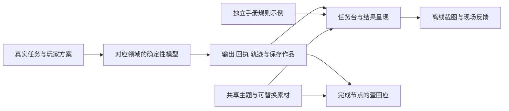

# 10月18日接续：先试玩，再选择

当前效率模态焦点修复位于bb5c817：源GUI245项、完整Windows176阶段及CI通过，双包构建身份通过。
新普通包首次父链216/219、三项失败，strict与测试者链未跑；保留失败，正在独审只读诊断日志补充。
第二次仅日志诊断在CPG快照正常后超时，缺最终JSON及全量计数；未改判首失败，待原等待点遥测。
[本轮证据/交接](../verification/20261018-narrative-modal-focus/README.md)保留旧基线239项/4错误。
当前已验d14双包与次日问题见[CreationLinks交接](../verification/20261018-creation-connections/README.md)。
早先可替换创作框架见[历史创作呈现](../verification/20261018-creative-framework/README.md)。
此前全旅程阶段保留在[F1证据](../verification/20261018-full-journey/README.md)。
本页以下保留原7c候选身份与其限定证据，不自动认证新分支或新包。

## 7c历史版本

本轮从已合并的 PR10／`bf8f616` 继续。开发分支为
`codex/night-experience-20261018`。公开下载仍是10月17日离线版；本轮候选
只交本地固定包与审阅分支，尚未公开发布。精确包名、SHA与验证结果见
[夜间验收记录](../verification/20261018-night-experience/README.md)。
分支已推送至`98944d1`并交付[草稿PR #11](https://github.com/wizardpc-com/von-neumann-bottleneck/pull/11)；
包SOURCE仍固定为`7c4f9b58e4229864ccf29aa066de85a183d33924`。

普通进度版使用 `NightExperience20261018`；协作全关版使用
`OfflineTeammate-Night20261018`，不自动读取10月17日的 `OfflineTeammate`。
两者独立保存，互不赠送进度；旧安装包与原存档保留。勿用 QA 通关档替代新档。

固定源码：`7c4f9b58e4229864ccf29aa066de85a183d33924`；Windows 数字版本 `0.5.0.267`。

| 用途 | 本地文件（ZIP与外置manifest一起交付） |
| --- | --- |
| 普通进度 | [NightExperience ZIP](../../build/playtest-NightExperience20261018-7c4f9b58e422/Von-Neumann-Bottleneck-Windows-playtest-NightExperience20261018-7c4f9b58e422.zip) · [manifest](../../build/playtest-NightExperience20261018-7c4f9b58e422/manifest.json) |
| 全关协作 | [NightAccess ZIP](../../build/playtest-NightAccess20261018-7c4f9b58e422/Von-Neumann-Bottleneck-Windows-playtest-NightAccess20261018-7c4f9b58e422.zip) · [manifest](../../build/playtest-NightAccess20261018-7c4f9b58e422/manifest.json) |

完整解压后运行 `Windows/Von-Neumann-Bottleneck.exe`。无需安装 Godot。
外置 manifest 记录60项内容、profile与完整SHA；ZIP内的 `BUILD-MANIFEST.json`记录文件哈希。
普通ZIP SHA以`d448488ae888`开头，全关ZIP SHA以`d67065e13347`开头；
[完整身份与验收](../verification/20261018-night-experience/package.json)。
两包已通过实际解压、启动与首段体验控制器验证；C→P→G保存／重启／配方重放和
最后一次反馈ZIP的4案例／2会话验证在全关包完成。普通包未独立重跑后者。
原生OS观察与真人理解另列，不能将控制器调用说成真人鼠标拖线。
本轮全关包另有真实Windows鼠标／键盘16项限定观察：新档0/5、两次拖线、
A1／灯0、拆线重连后的真实5/5及壹回应、F8与单字母`n`自动保存、独立进程重启
和两次正常退出0。意见原修订及电路字节保留；未建立旧意见下拉界面恢复。
长／中文输入仍未验证：`Sky.type_text`未插入，普通按键`n`成功。
[原生范围与限制](../verification/20261018-night-experience/native-receipt.json)
· [原生完成画面](../verification/20261018-night-experience/native-earned-tutorial-zh.png)。

| 交付类别 | 7c当时范围 |
| --- | --- |
| 已实现、技术验证通过 | 首段真实操作、独立规则示例、中期证据指导、共享主题与C/P/G入口；两份固定Windows包及各自验收回执。 |
| 已实现、待真人审阅 | 壹的语境与回应、视觉舒适度、陌生玩家理解、继续试玩意愿及主观听感。 |
| 独立实验 | 同数据浅色／深色比较样张；浅色未成为全局设置。 |
| 本轮未做 | Mac新包、公开Release、3D／双空间、排行榜和最终CG／人设；分别受平台观察、发布授权或既定范围约束。 |

工程交付关闭与真人／平台验收仍开放可以并存；后者不借用自动化结果代替。

## 优先试玩的四段

1. 普通版首页→开始旅程→阅读或跳过壹→NOT接线、切换输入、运行、拆线、重连。
   看任务台确认真实目标。NOT 输入1时输出0，灯灭可以是正确结果。
2. 手册→NOT／AND／半加器→点击A、B→读对应输出与真值表→Esc回自己的原方案。
   示例与自己的电路独立。规则始终可查；策略仍由分级Hint按需提供。
3. 协作版地图→第一章 `cpu_speed`→提交预测、运行完整基线→按任务换一种CPU再运行。
   任务台说明尚缺的比较证据；运行结果、旧基线与当前未运行控件分别归属。
4. 地图上方→压缩C1→学习、发送预测包并无损复原→内容预测P1提交／揭晓并完成整轮
   →创造G1回灌生成→G2／G3命名保存→退出重开回看。入口开放不免除模型准备。

全关版按F8／现场反馈，记录不清楚的位置；多次试玩后导出一个ZIP即可。
自动上传关闭。发给维护者前自行确认文件内容；不在意见中放私人凭据。

## 最多五个需要人判断的问题

| 审阅问题 | 进入路径与两个观察点 |
| --- | --- |
| 壹的开场是否足够克制？ | [实包首页讯息](../verification/20261018-night-experience/images/introduction.png)：保留现在的短语境，或进一步缩短；身份／声线／形象仍待团队决定。 |
| 开始后是否知道第一步？ | 新档从首页进入，不先看演示。先问「现在要做什么」，再观察接线；不要立即替玩家解释。 |
| 图示是否真正帮助理解？ | [实包半加器](../verification/20261018-night-experience/images/rules-after.png)：能否解释1+1为何是SUM0／CARRY1；比较直接点击与只看文字。 |
| 深色还是浅色更安心清楚？ | [深色](../verification/20261018-night-experience/images/theme-dark.png)／[浅色](../verification/20261018-night-experience/images/theme-light.png)使用同一数据；浅色仅是比较样张，尚非全局设置。 |
| 中期及创造是否愿意继续？ | 先读缺失证据，再走C→P→G。区分规则不懂、操作找不到、策略尚未想出，保留具体现场。 |

陌生玩家、已看过演示的队友和开发者熟练操作分别记录，不合并成「新手已懂」。
人员主责、排序与截止安排沿用团队现有决定。

## 素材与叙事接入

[素材接口表](night-art-interfaces.md)列出面板、按钮状态、背景、字号和覆盖边界。
所有动态技术文字保持原生；背景／九宫格／图标可独立交付，附作者、来源、许可与AI辅助说明。
本轮新增界面由程序绘制，未引入来源不明的参考图。

`mission_narrative_catalog.gd::introduction()` 提供标题、语境、具体目标、操作和帮助分工；
`completion_response(chapter_id, level_id, english)`提供五个真实完成节点的候选回应。
`yi_introduction.gd`只负责文字呈现与开始／跳过／返回；替换台词不改模型或存档。
媒体缺失仍有文字与操作路径；未增加正式CG、人物建模或在线AI依赖。

此图展示信息归属，各领域沿用自己的模型；不表示早期电路执行后期所有算法。

## 检查点与恢复

- `bf8f616`：合并后的离线基线；`913d51e`：执行计划。
- `5b83ee6`：第一段体验、互动规则、主题与地图入口。
- `d270a16`：中期缺失证据与实际控件检查。
- `9b2c624`：独立夜间存档及解压包验证；`5a7b673`：调色板断言与拖拽绘制检查修正。
- `7c4f9b5`：两包固定源码；之后的回执与文档提交不改变包身份。
- `657e2a7`：外置实包图像／可见性验证控制器；未改变固定7c产品和包字节。

在独立工作树查看对应提交，勿重置带个人修改的原检出。
原检出 `tests/test_ui.gd` 的未明删除未被本轮覆盖、提交或带入候选。
保留`.godot/verification/`、`.godot/night-render/`、`.godot/night-package/`原始记录；
版本化回执与图像见验收入口。继续开发前先读AGENTS、协作记录与最新Git状态。

最终技术健康：本地完整运行保留164/165（旧色板断言失败），修正后受影响8/8及
1293项断言通过；渲染15/15、Python11项命令和两包控制器验收通过。
完整结果按各自版本归属，不能拼成一次虚构的本地165/165。
同一固定7c源码的 GitHub Linux CI 另行通过165/165阶段及11项Python命令；
[精确CI身份](../verification/20261018-night-experience/ci.json)。
复测命令见验收入口，当前文件所有权与唯一引擎令牌见忽略的
`.godot/collaboration/handoff.md`；新协作者先核准工作树和实际包身份。

## 未纳入本轮

3D／双空间、排行榜、完整CG和最终人设未成为正式路线；没有公开Release、
VPS／域名操作或存档迁移。当前Mac原生、异机Windows首启、陌生玩家理解、
主观听感和最终美术验收仍需相应人员观察。PPT／视频使用实机截图和操作路径，
本轮未替团队制作或定稿成片。
