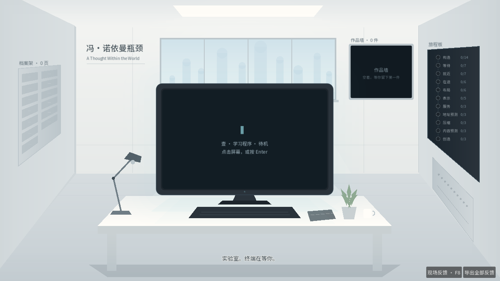
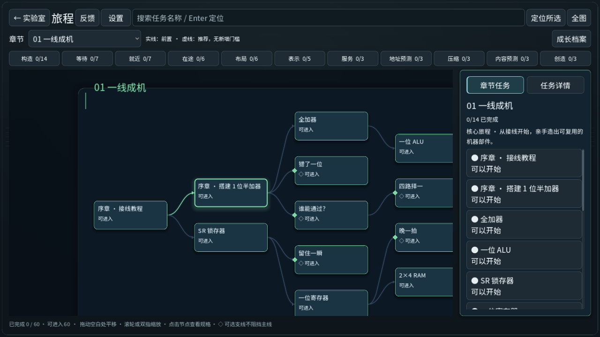
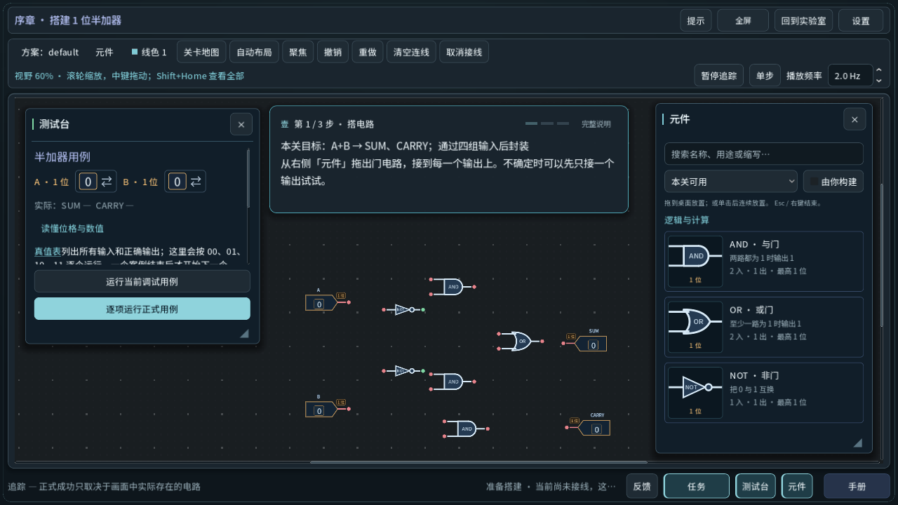
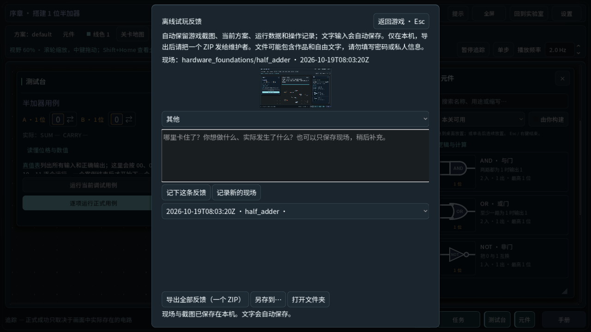

# 队友试玩与开发交接

本轮目标是 Windows 团队试玩与工程收尾。试玩 ZIP 来自合入后的固定 `main`
提交；具体提交、ZIP 校验值、验证结果和截图来源以
[本轮交付记录](../verification/20261019-team-closeout/README.md)为准。
生成的 ZIP、导入缓存、测试存档不提交源码仓库。本轮未公开发布 Release。

## 发给队友

把 Windows 测试 ZIP 整包发给队友，提醒先完整解压，再运行里面的 EXE。
[随包中文说明](../../distribution/OFFLINE-PLAYTEST-README.txt)包含操作、
C1→P1→G1→G3 路线、F8 反馈与更新备份方法，可直接转发。

- 初次体验：实验室点击终端/Enter，先亲手做 NOT 教程，再回实验室看看变化。
- 自由试玩：终端「旅程」或右墙旅程板选关。60 项入口全开，完成仍需真实操作。
- 遇到问题：F8 写下“关卡、操作、预期、实际”；结束时导出全部反馈，发最新一个 ZIP。
- 请优先记录卡住、按钮找不到、接线困难、目标不清、显示被挡等实际体验。
  不要求队友先通关，也不需要他们安装开发工具。

本轮实际游戏截图：

| 实验室 | 旅程地图 |
|---|---|
|  |  |

| 硬件工作台 | 现场反馈 |
|---|---|
|  |  |

## 版本与边界

当前主线包含 Claude 的实验室旅程：首页终端、旅程板、档案架、作品墙，
跟随真实操作的 NOT 教程，以及完整 60 项入口。普通进度与测试入口分别处理；
开放测试入口不会代替造机、真实用例、学习模型、作品保存或完成判定。
此包仍用正常 Game 规则，不是开发用 Test 模式；临时参考组件不产生正式封装或通关。
本轮只收敛影响试玩、构建和交接的问题。修复明细见本轮交付记录；
下一轮再由团队决定玩法、美术、故事和教学扩展。

本包为完全离线 Windows 测试版，未配置反馈服务器，不自动上传。
Windows 未作正式代码签名。小屏/高 DPI/手感与陌生玩家理解需要队友验证。
地址预测是临时探索；作品按原工作台保存合同处理。
[随包已知问题](../../distribution/KNOWN-ISSUES.txt)保留各领域限制。

## 接续开发

先读 [AGENTS.md](../../AGENTS.md)、[协作规则](collaboration.md)、
[当前状态](../CURRENT_STATE.md)、[测试命令](testing.md)，再读
[实验室旅程代码地图](LAB_JOURNEY_HANDOFF_20261019.md)。
后者是功能交接记录，其中日期、旧包与机器磁盘情况属于历史快照；
当前交付身份以本轮记录为准。

| 要改什么 | 先找哪里 |
|---|---|
| 实验室/终端/色板 | `src/lab/`，统一色板 `lab_palette.gd` |
| 原硬件与教程 | `src/hardware_foundations/` |
| 地图与任务入口 | `src/campaign/task_navigation.gd`、`src/campaign/task_tree.gd` |
| C/P/G 与作品保存 | `experiments/creation/` 与其中的 `CONTRACT.md` |
| 离线反馈 | `src/playtest/offline_feedback.gd`、`offline_store.gd` |
| 构建与身份核验 | `scripts/build-free-candidate.py`、`check-candidate-identity.py` |
| 导入队友反馈 | [维护者说明](../../distribution/OFFLINE-MAINTAINER.txt) |

模拟结果、计分和完成条件由模型决定，界面只展示；不要用动画或入口状态补造结果。
不提交队友反馈 ZIP、私人讨论、QA 存档或构建缓存；反馈先本地导入去重再分析。
同一时间只由一位协作者执行 Git 变更或 Godot；其他人先确认文件所有权。

## 重建同一份 Windows 包

完整流程见 [构建说明](../distribution/free-alpha.md)。需要 Git、Python 3、
Godot **4.7.1 stable** 和匹配的官方 `windows_release_x86_64.exe` 导出模板。
引擎和模板不在 Git 中，换电脑需另外准备。

```powershell
$frozenCommit = '固定最终 main 的完整 40 位 SHA'
$batch = '新的不可复用批次名'
$profile = 'OfflineTeammate-Team20261019'
python scripts/build-free-candidate.py --godot '../godot-4.7.1/Godot_v4.7.1-stable_win64_console.exe' --commit $frozenCommit --platform Windows --windows-template '../von-neumann-bottleneck/build/template-cache/templates/windows_release_x86_64.exe' --second-act-profile $profile --creation-journey --offline-tester --test-batch $batch
$candidate = "build/playtest-$batch-$($frozenCommit.Substring(0,12))"
python scripts/check-candidate-identity.py $candidate
python -X utf8 scripts/verify-offline-playtest.py --exe "$candidate/Windows/Von-Neumann-Bottleneck.exe"
```

以上模板路径是本机已存在的位置，其他电脑应替换为实际位置。
构建器只归档指定提交，不从当前工作区复制未提交文件。它生成独立构建/导出目录，
打包许可、中文说明与关键截图，并核验文件清单和 SHA-256；不附带玩家存档。
离线反馈探针在独立 QA 目录运行，检查真实导出 EXE 的 60 项入口、跨重启反馈、
截图和最终一次 ZIP 导入；它是自动探针，不代替队友亲手试玩。

测试 profile 位于 `%APPDATA%/VonNeumannBottleneckCandidates/` 下的
`representation/<profile>/` 和 `service/<profile>/`。创作与实验室状态位于前者。
新批次使用独立 profile 保留旧存档与反馈；重用同名 profile 表示继续该渠道。
更新/回退前退出游戏并完整备份两个目录，不把 QA 数据写回玩家目录。

## 文件整理

源码、正式说明与验证记录留在仓库；最终 ZIP 放独立交付目录。
开发缓存和临时 worktree 不属于交付内容。已有未提交工作、原始存档、
历史反馈与旧构建分别保留；目录归属和交付位置以本轮记录为准。
