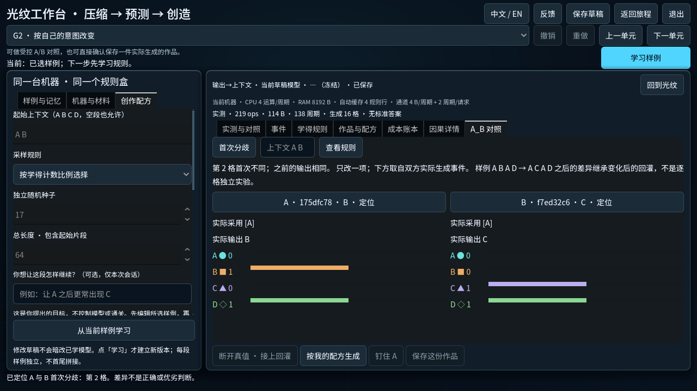
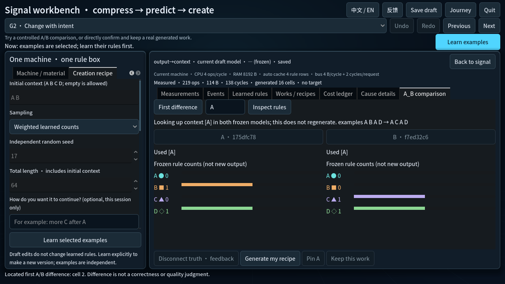
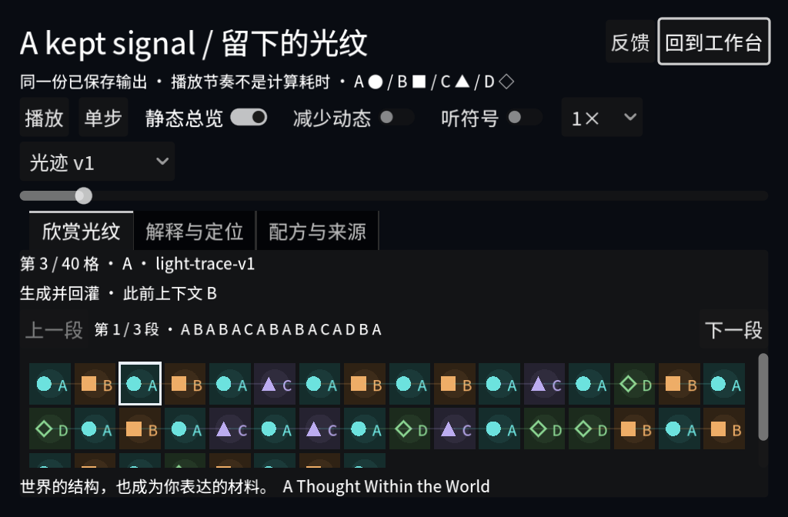
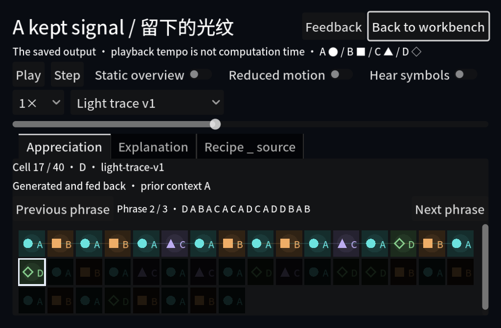

# Compression, prediction and personal expression candidate

The unmerged PR #7 candidate freezes `f26131049877601334646442b1c9f6f3864ef299`
as `playtest-CreationExpression20261013-f26131049877`. Both packages include the
complete sixty-task journey, pinned Godot4.7.1 and stable `CloudPlaytest` save
channel. They remain offline with local feedback/export and upload disabled.
Earlier frozen candidates are preserved.

## Observable changes

| Area | Previous experience | Current experience |
| --- | --- | --- |
| P3 discovery | Opening named the exceptional contexts and check-stream surprise. | Opening asks players to discover contexts and exceptions through the existing independent practice and frozen checks. |
| A/B consequences | First difference located output cells; explaining a changed rule required inspecting separate traces. | Expanded comparison places actual changed samples/settings, frozen identities, chosen symbols and eight successor counts together. Context lookup also exposes unchanged-output rule differences and fallback. Multiple factors and seed-only changes carry no single-design attribution. |
| Saved work | Position, full view and source explanation were separate; navigation used individual cells/timeline. | Verified initial/feedback origin appears beside the selected artwork cell. Previous/Next phrase follows actual sixteen-cell groups, including the final short group. |
| Listening | Saved output had visual playback. | Default-off A–D short tones follow actual newly revealed saved symbols through Effects. Seek is silent; pause, focus loss, hide and close stop sound. The last symbol receives its finite cue. |

Model, codec, sampler, costs, legal solutions, completion gates and persisted work/
recipe formats are unchanged. Content identity is `tasks-20261013-journey-v1`;
the receiver retains both prior journey manifests and rejects crossed identities.

These images use disclosed authored fixtures, not earned player progress or
native pointer input. The saved-work window is640×420; comparison is1280×720.

## Verification and limits

- Final affected isolated checks:7/7 PASS, including import/user isolation and
  comparison view, exhibition composition, work focus, listening and workbench.
  Evidence: `.godot/verification/20261012T194358Z-0df8859c/`.
- Final real Windows renderer: both suites PASS; listening76 assertions. All
  eight comparison bars fit the visible pane in both languages. Last-tone natural
  `finished` signals were observed after177ms/175ms, with playback stopped.
  Evidence: `.godot/creation-expression-20261013/render-bbba542a/`.
- Earlier content checks: actual client/receiver identity20 assertions, commission
 17 assertions, receiver10 tests and packaging checks PASS. Prior task manifests
  remain intact; P3 authored material/model and legal conditions were preserved.
- Frozen candidate identity: archive names/sizes, all packaged file hashes,
  source/build/content identity and notes PASS. [Exact receipt](receipts.json).
- Same-source actual Windows feedback export (`CreationLocalQA20261013`): offline
  save, reopen/HTTP receipt, same-ID private SQLite report/triage, retry deduplication
  and delete/old-backup restore PASS. Evidence:
  `.godot/package-feedback/202af48a58b2/`. This separate localhost acceptance package
  keeps its baked endpoint/build/content unchanged; it is not the offline
  distributable package or VPS HTTPS acceptance.
- Independent read-only review found no actionable model/save/completion boundary
  defect. The reviewer did not rerun controller checks.
- Full fixed-runtime CI [38300271114](https://github.com/wizardpc-com/von-neumann-bottleneck/actions/runs/38300271114)
  and documented-head CI [38300335632](https://github.com/wizardpc-com/von-neumann-bottleneck/actions/runs/38300335632)
  PASS:154 Godot suites plus import/user isolation156/156, and all nine Python
  commands. Raw logs were downloaded and checked for unique PASS/FAIL rows.
- Windows OS-native representative acceptance PASS on2026-10-16, using the
  unchanged frozen EXE and existing private QA profile. Previous phrase reached
  cell33; Step reached34; Play advanced and Pause stopped at53. Source labels and
  four-lane viewing followed the same saved output. Save draft succeeded. A second
  independent process restored the64-cell work and original local opinion ID;
  English appreciation and default-off sound were observed. Both normal Quit
  actions ended their process and released the owned writer lease. All session
  fields, protected work and recipe remained unchanged.
  [Native observation and read-only checks](native-windows.json).
- The earlier lock-screen attempts remain historical failures, not native passes.
  WTSInfoEx confirmed the session UNLOCKED before the successful2026-10-16 run.
  No Windows settings or authentication were changed. This acceptance covers
  native controls and restart; subjective acoustic quality was not assessed.
- Mac native, unfamiliar-player understanding and subjective listening/artistic
  acceptance are NOT_RUN. Current content identity has not been deployed to VPS;
  earlier private HTTPS acceptance remains attributed to its earlier source.

Retained diagnostic runs: TypedArray membership errors at
`20261012T193137Z-42e05fd7` were repaired using direct button identity checks.
The first rendered comparison at `render-1c2b53d9` exposed clipped counts;
expanded evidence and geometric assertions repaired them. `render-a328898d`
failed an overly short150ms endpoint wait; final checks require the natural
finished signal within1s, a stopped player and a finite nonlooping60ms WAV.
These records remain private and are not relabelled as passes.

The candidate is ready for Claude's overall art refinement and a small controlled
offline playtest. Unfamiliar-player understanding and subjective listening/artistic
acceptance belong to those next-stage observations; current Mac native remains
unverified. No merge, Release, domain, public ingress or production feedback intake
is authorized by this delivery.
