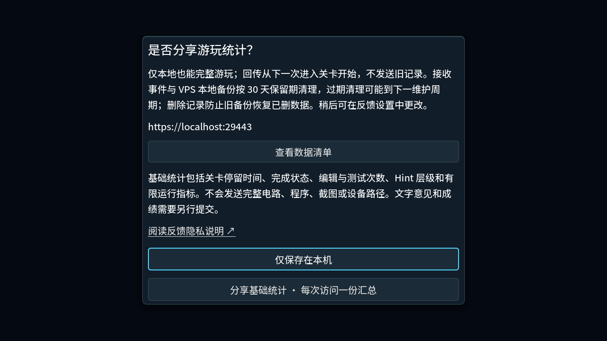
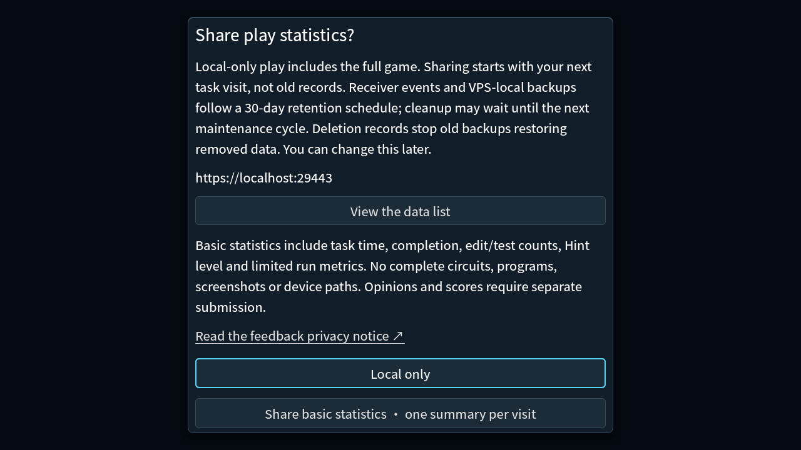

# Windows draft and private feedback readiness — 2026-10-17

PR7 merged as `94b5bff`; `archive/pre-release-20261012` preserves its original
31-commit source history. This round prepares a Windows-only **Release draft**.
The owner explicitly deferred publication until the feedback domain is ready.
The existing public forty-task Alpha is unchanged. All sixty candidate tasks,
legal solutions, model rules and the stable `CloudPlaytest` save channel remain.

## Changes visible to players and the operator

- Optional sharing has an explicit configured HTTPS privacy link in both the first
  choice and feedback settings. The new notice requires renewed cloud consent;
  local drafts, protected works and deletion identities remain intact. Prior and
  current notices remain accepted by the receiver, including experimental scores.
- Idle service polling applies event retention. Slow accepted request bodies have
  a total five-second deadline. The proxy's 120/minute receiver limit is shared,
  not a per-player capacity claim.
- A separate unprivileged localhost receiver and independent TLS proxy are enabled
  on the existing VPS. Daily private maintenance writes consistent SQLite backups,
  source/schema/count/hash metadata and refreshed private reports. Its managed
  snapshots rotate after thirty days; anomalous copies visibly fail maintenance
  and require private operator review rather than guessed deletion.
- Restore verifies a selected backup, merges the latest full deletion state and
  creates a new destination. If trustworthy current deletion state is unavailable,
  an old backup must not go online. Tombstones are not expired with ordinary events.

## Fresh evidence

| Check | Result and scope |
| --- | --- |
| Isolated Windows Godot 4.7.1 | **PASS 156/156:** 154 suites plus import/user isolation, `.godot/verification/20261016T185219Z-180d5b3d`. Final explicit443 URL change additionally passed remote-feedback suite plus2 gates at `20261016T190725Z-d9e886d5`. |
| Python | Receiver7, community16, maintenance4 and packaging checks PASS. Actual VPS runs of receiver/storage/delivery/private-report/maintenance all PASS; latest maintenance includes collision and incomplete-copy failures. |
| Bilingual 1280×720 renderer | **PASS:** privacy first choice, expanded data list and visible local/basic actions; screenshots below. This is rendered controller input, not OS input. |
| Actual Windows EXE → private HTTPS → VPS → private report | **PASS:** fixed client/receiver `beca837894481165e6e04afe93f4e879645c1d29`, full60, offline queue, independent restart, same-ID/task/build acknowledgment, duplicate count1 and unchanged protected work. [Receipt](package-feedback.json). |
| Backup → delete → restore | **PASS:** old snapshot held the opinion; deletion cleared live/report/triage; merged restore held0 events/1 tombstone. An actually started restored receiver rejected the old upload with410. |
| VPS isolation | **PASS:** own restart/health, private0700/0600, enabled daily timer, request121→429, original service PIDs and Caddy bytes unchanged, all protected historical file hashes unchanged. [Sanitized receipt](vps-isolation.json). |
| Private TLS and routes | **PASS:** health/privacy only as allowed; admin/community/wrong methods denied; private CA not globally trusted. [Routes](https-routes.json). |

Two failed private harness attempts remain in the ignored evidence: one used a
profile without the required QA prefix and exited before gameplay; another bound
only IPv4 while `localhost` selected IPv6. Corrected QA naming and dual-loopback
SSH forwarding passed. No game workaround or global certificate installation was
used. The EXE/PCK stayed byte-identical throughout the accepted run.

## Release and external boundaries

The Windows offline draft artifact, final source/hash/native receipt and draft URL
will be recorded after the protected integration. It must keep its endpoint empty.
The private acceptance package uses a separate localhost endpoint and QA override;
it is not the public artifact and does not prove internet ingress.

`feedback.yanruiqing.com` is planned only: not purchased/resolved, no verified
filing/access status, no public ports/TLS. The owner/contact are yanruiqing and
`yanruiqing@agent.qq.com`. VPS-local backups follow the thirty-day maintenance
policy; deletion does not instantly erase old copies, and failed cleanup requires
operator intervention. Offsite backup is deferred. Current Mac native, unfamiliar
player pacing and subjective art/listening acceptance remain separate.
See [operations and DNS worksheet](../../distribution/feedback-operations.md) and
[current acceptance gates](../../../RELEASE_BLOCKERS.md).
