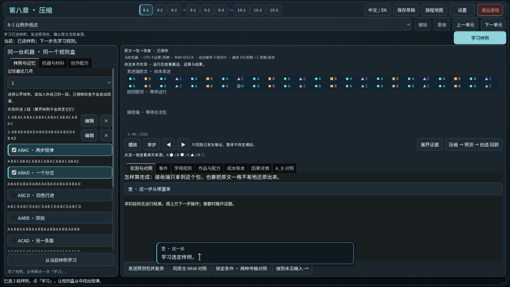
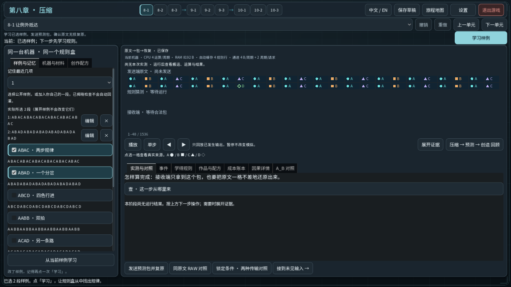
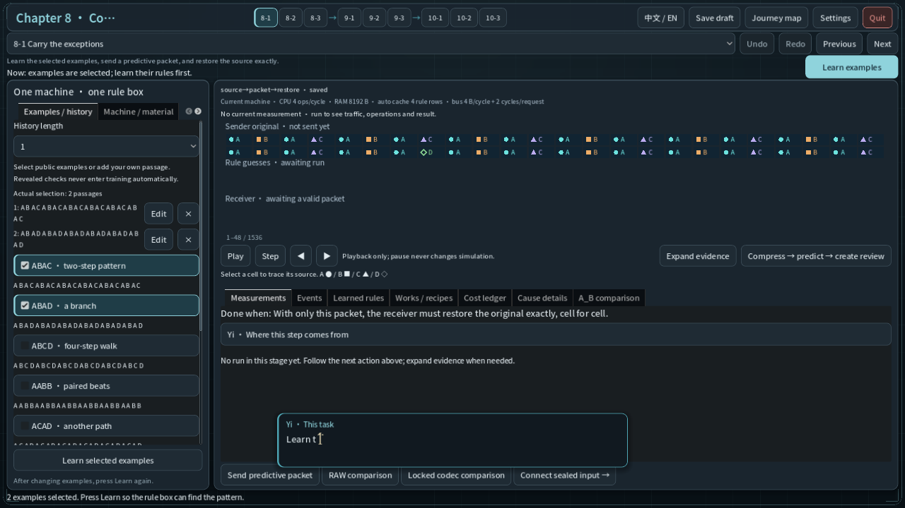
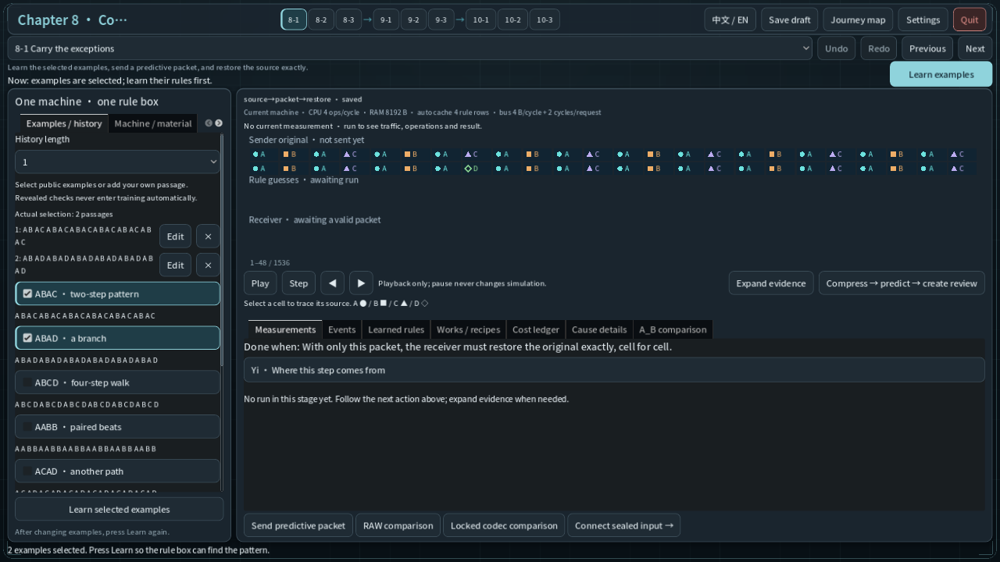
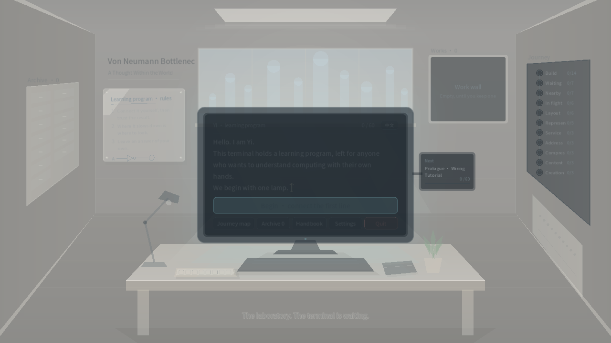
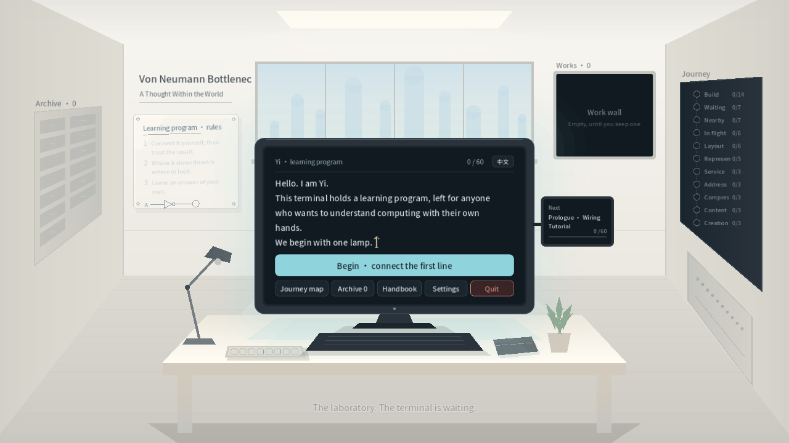

# 终端表现收尾（2026-10-20）

基于已交付的导航修复 `e965632ef56601fba36926c105335de95a65f27b`，
分支为 `codex/navigation-closeout-20261020`。

## 改动

- 玩家开始键盘输入或点击工作台操作后，开场提示及时收起，不再等待逐字输出结束。
  保留原有 0.6 秒入场保护；提示仍不抢焦点、不拦截点击，未开始操作时保留阅读和自动退场逻辑。
- 开启「减少动效」后，开场提示直接改变透明度、直接退场；实验室待机灯保持稳定，
  唤醒终端不淡入，进入和返回实验室不等待整页淡入或拉远过渡。
  普通模式的文字、位置、配色和过渡时间保持原样。

仿真、判定、任务编号、进度、存档格式和作品合同不变。
面板大幅重排、新图标、声音设计和叙事候选没有纳入本轮。

## 实际渲染对照

均为 Godot 4.7.1、1280×720 的隔离源码窗口。开场提示检查使用原有任务文字，
把输出速度固定为每秒 5 字，稳定复现「文字尚未结束时开始操作」。
用户输入通过 viewport 发送；这不是原生 Windows 键鼠或陌生玩家验收。

| 场景 | 修改前 | 修改后 |
| --- | --- | --- |
| 中文：开始输入后 |  |  |
| English: after typing |  |  |
| 中文：减少动效下唤醒 |  |  |
| English: reduced-motion wake |  |  |

## 验证方式

`tests/test_terminal_presentation_polish.gd` 检查中英文、键盘输入和真实按钮点击、
输入透传、模型／草稿／作品不变、待机指示、唤醒与返回，以及减少动效下的提示退场。
额外使用 `--polish-capture --capture-size=1280x720` 生成上述截图。

相同测试脚本在修改前的隔离版本产生 16 项预期失败，修改后有渲染检查 **36/36 通过**。
源码、测试和 8 张截图的哈希见 [render-evidence.json](render-evidence.json)。
本地完整日志分别在 `.godot/polish-render/before-633110a6/` 和
`.godot/polish-render/after-4101e2b5/`。

## 交付验证

- 固定 Godot `4.7.1.stable.official.a13da4feb`：完整 headless 回归 **183/183 套件通过**，
  导入与用户目录隔离检查均通过；新增表现检查 **32/32 通过**。
- 本地完整日志：`.godot/verification/20261020T142311Z-3425b8b7/`；
  `results.json` 记录套件结果，`source_identity.json` 确认三个运行文件和测试与当前源码一致。
- 使用 `python -X utf8 scripts/verify-project.py --godot <固定 4.7.1 控制台程序>`，
  `TEMP`、`TMP` 指向 `E:\VNB\temp`。测试存档独立，不使用玩家存档。
- 8 张中英文截图均已查看，SHA-256 和 1280×720 尺寸校验通过；`git diff --check` 通过。
- 未运行独立的 `test_recovery_game_input` GUI 套件；未做原生 OS 键鼠、导出包或陌生玩家验收。
  本轮不合并主线或发布游戏包。
