# 2026-10-20 · 美术与两个世界（第二轮）· 截图与验证

源码：`c99d720`（main）+ 第一、二轮未提交修改。截图全部来自 Windows 上的 Godot 4.7.1 stable
（`4.7.1.stable.official.a13da4feb`），窗口固定 1280×720。截图通过 `--dev-*` 路线参数驱动，并使用独立的 `APPDATA`，
不读写玩家存档。这些是自动路线输入，**不是人工键鼠试玩**。哈希见 [SHA256SUMS.txt](SHA256SUMS.txt)。

## 修改前 / 修改后

| 场景 | 修改前 | 修改后 |
|---|---|---|
| 实验室（唤醒） |  |  |
| 在实验室按 Esc | 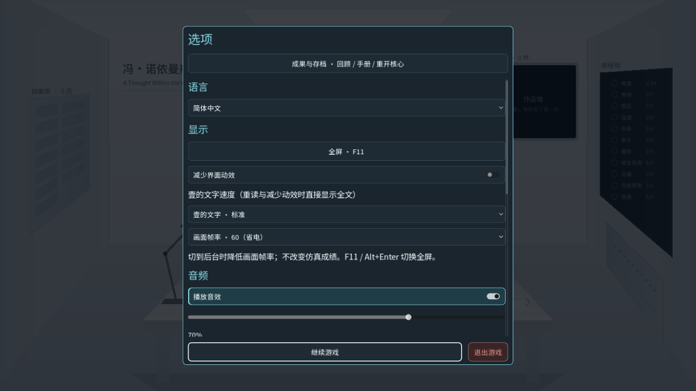 原来打开设置 |  在终端屏幕上询问是否退出 |
| 进入终端途中 | 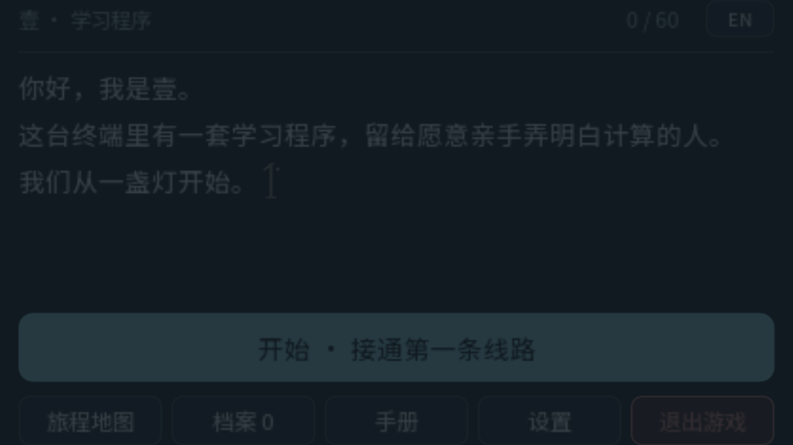 放大模糊的菜单 | 见下方过渡序列 |
| 第一关工作台 | 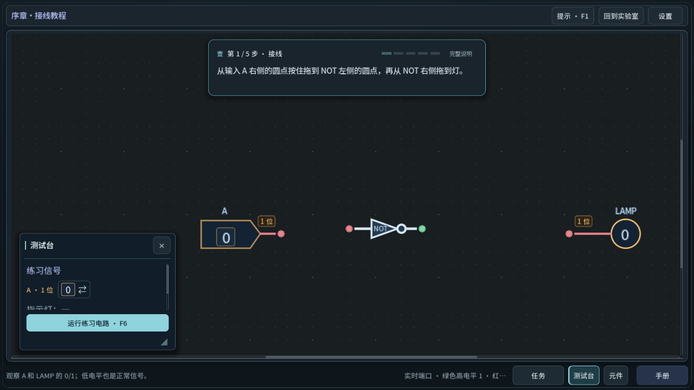 | 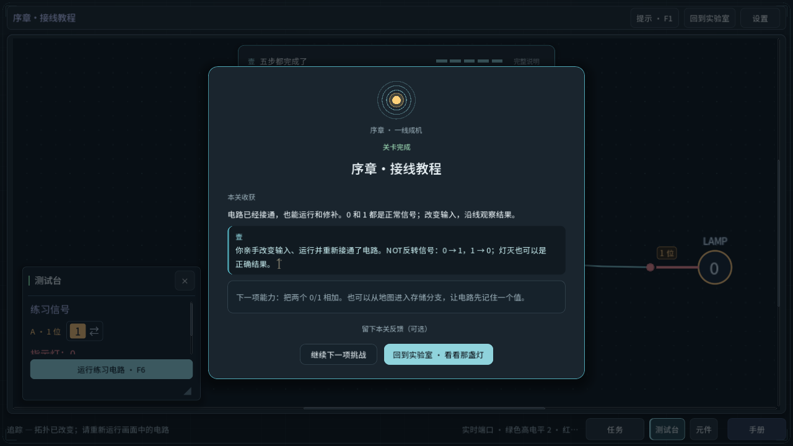 |

## 进入终端的过渡

左上→右下：实验室中菜单淡出 → 屏幕收成一条光线 → 全黑中的光线 → 工作台从光线上下展开 → 展开中 → 第一关完成卡。

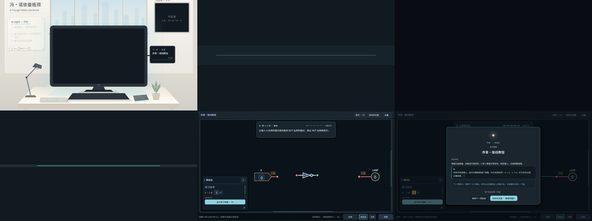

## 实验室随真实进度变化

| 说明 | 截图 |
|---|---|
| 新档待机：记录板三条守则都很淡，托盘空，状态屏显示「序章·接线教程」 | 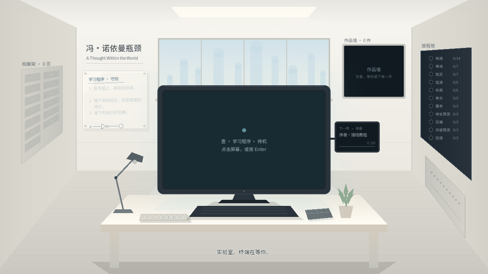 |
| 完成第一关后（真实接线、切换、运行、拆线、重接）：台灯亮；守则第 1 条写上；草图中的灯点亮；托盘放入 NOT；状态屏移到半加器，进度 1/60 | 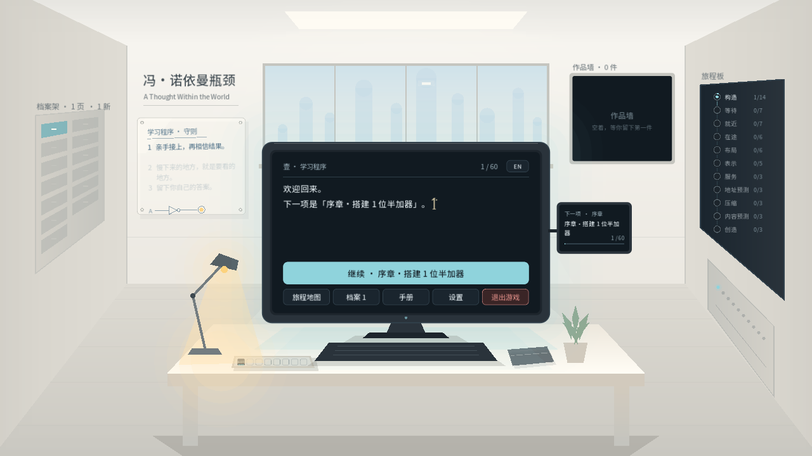 |
| 状态屏局部放大 | 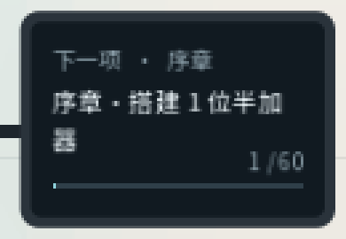 |

## 终端内的世界

| 说明 | 截图 |
|---|---|
| 序章·全加器：深蓝黑信号场与淡青网格，电路画布同色；步骤卡已扩展到本关 | 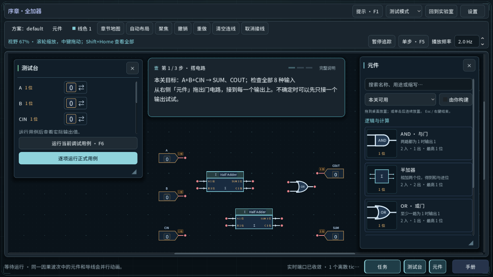 |
| 第一章 1-1：屏幕内框与四角角标；任务左栏、零件右栏 | 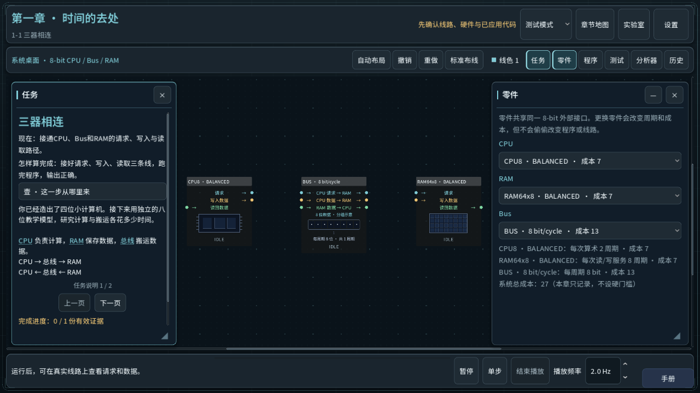 |
| 设置：五张卡片，标签与控件左右对齐；「退出游戏」暗红强调 | 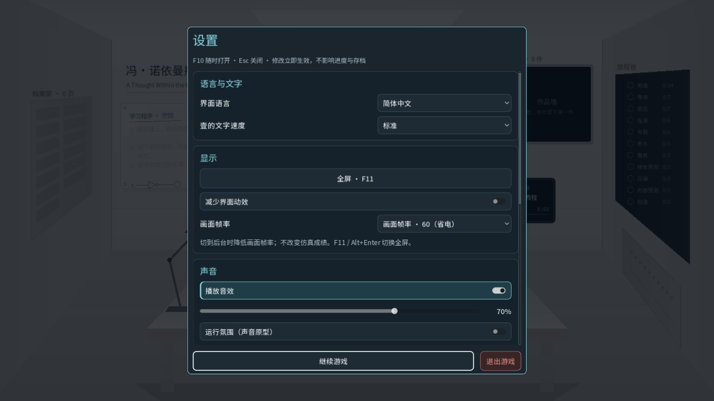 |

## 自动验证

使用 `python -X utf8 scripts/verify-project.py --godot <Godot 4.7.1 console>` 跑完整回归，每次都是隔离副本、独立用户目录：
**181/181 通过**（179 个常规套件 + import + user_directory）。证据目录：
`.godot/verification/20261020T013354Z-70322ebb`（不提交）。

- 新增 `test_two_worlds`（45 项）：覆盖终端退出询问的四种入口与是/否、到达过渡只播放一次且过期即忽略、画布配色、设置卡片与原有节点名，以及新物件只引用真实任务。
- `test_ui` 按新的 Esc 行为更新：在实验室按 Esc 询问退出，设置从终端打开。

回归之后只改了一处：状态屏字号 13 → 12。改后重新截图（`lab-after-first.png`、`zoom-status.png`），没有重跑回归。

## 未验证

- 人工键鼠试玩、过渡动画的手感与时长，以及陌生玩家能否看懂。
- Mac、高 DPI、全屏下的效果。
- 英文界面下的实验室新物件与设置卡片（自动测试只检查了节点与布局）。
- `test_recovery_game_input`（只能用 `--gui` 运行）。
- 没有导出新的 Windows 包。
