# 2026-10-20 · 壹的文字表现与 UI 收敛 · 截图与验证

源码基线 `c99d720`（main）+ 本轮未提交修改。全部截图来自 Windows 上的 Godot 4.7.1 stable
（`4.7.1.stable.official.a13da4feb`）真实渲染，窗口固定 1280×720，使用 `--dev-*` 路线参数与独立
`APPDATA`（不读写玩家存档）。截图是开发路线的自动输入，**不是人工键鼠试玩**。
文件哈希见 [SHA256SUMS.txt](SHA256SUMS.txt)。

## 修改前 / 修改后

| 场景 | 修改前 | 修改后 |
|---|---|---|
| 终端问候 |  |  |
| NOT 教程 | 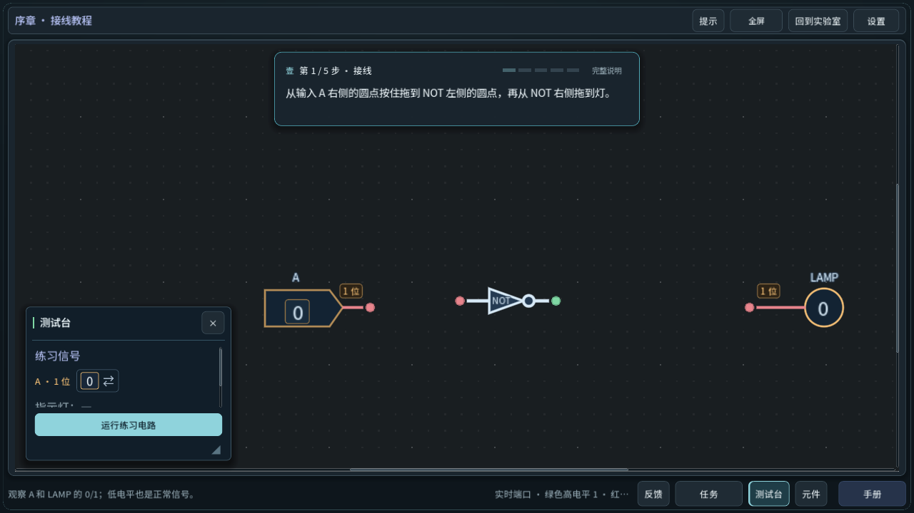 | 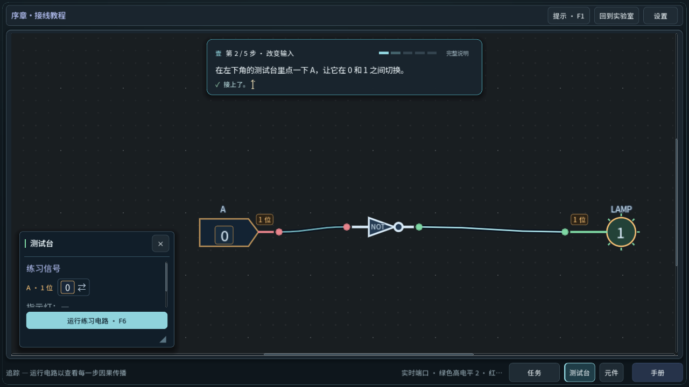 |
| 旅程地图 | 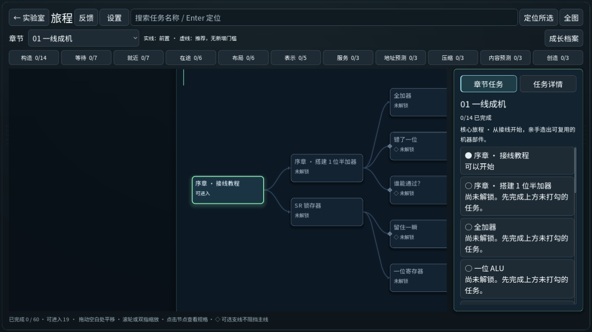 | 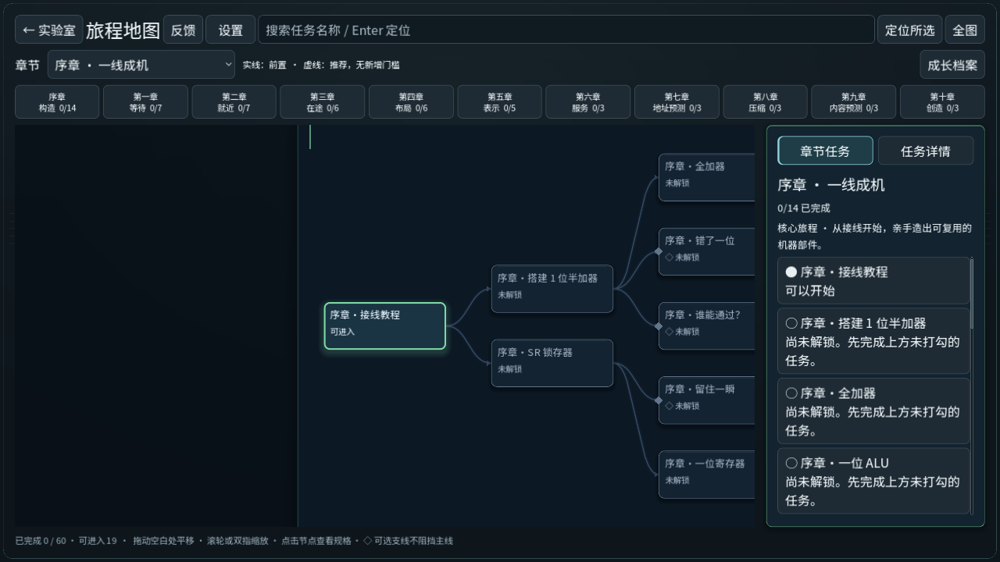 |

## 壹的尾随光标

| 说明 | 截图 |
|---|---|
| 终端问候输出中：光标在最后一个已显示的字后面 | 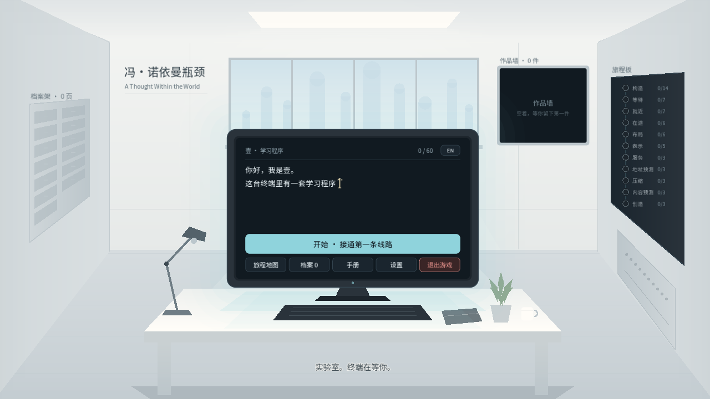 |
| 输出完成：光标停在「开始。」之后（17px 正文，24 号素材，局部 4× 放大） | 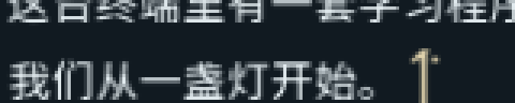 |
| 步骤卡中壹的短回应（15px，24 号素材，局部放大） |  |
| 英文：自动换行后光标落在实际最后一行末尾（实验室墙上英文标题被截断是此前已有问题） | 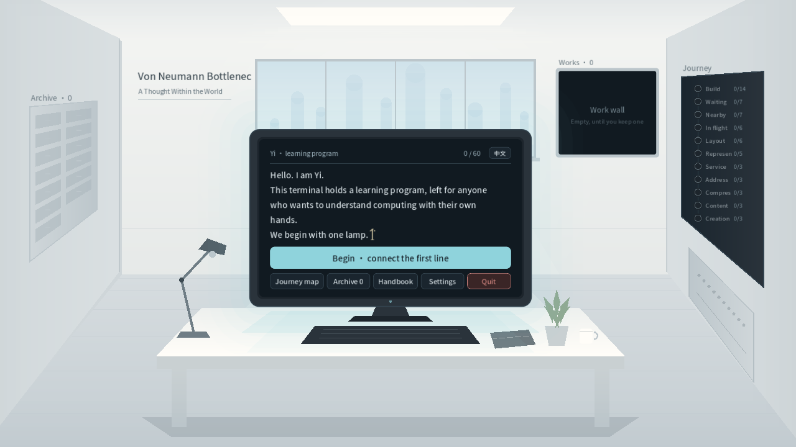 |
| 求助小卡（F1）：非模态，不覆盖步骤卡；输出该关第一级方向提示 | 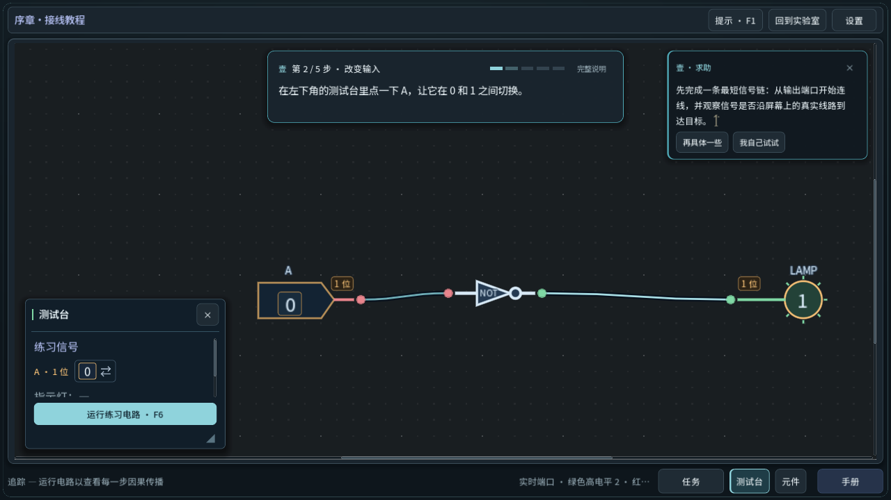 |
| 完成卡：系统结果先即时显示，壹的短评稍后开始（光标在行首） | 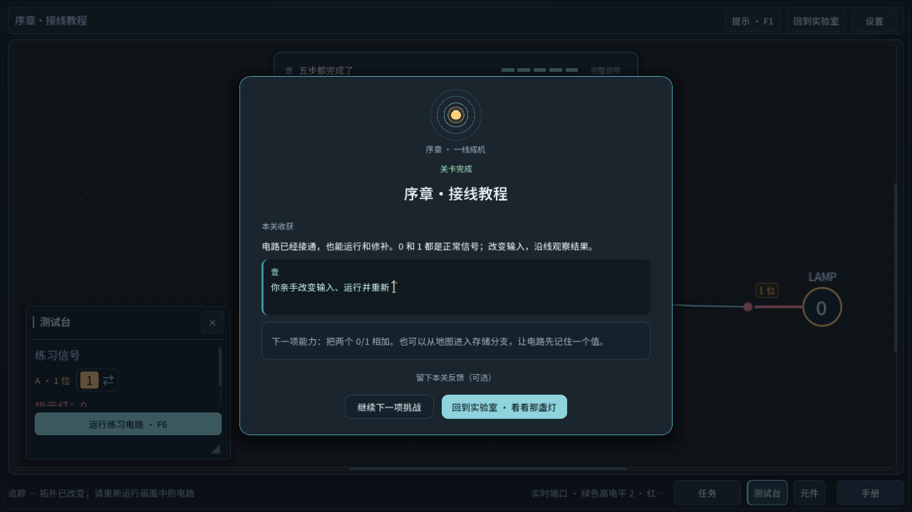 |
| 完成卡：短评完成，卡片高度与按钮位置不变 | 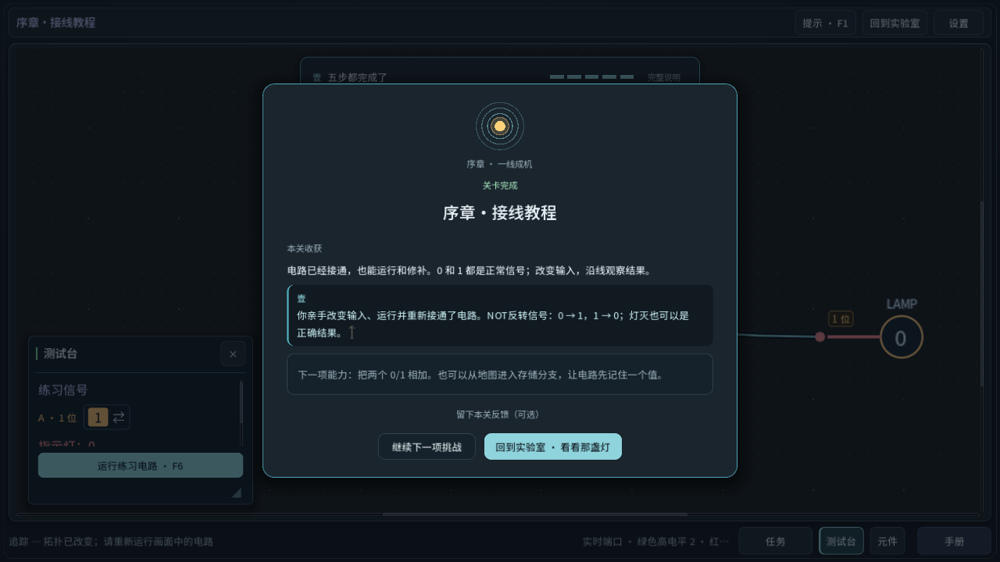 |

32 号素材由 `test_yi_typewriter` 在 26px 正文中选中并检查位置，但**当前游戏界面没有使用 26px 以上的壹正文，32 号未做实机截图**。

## 按钮、设置与工作台

| 说明 | 截图 |
|---|---|
| 设置：「全屏 · F11」只在这里；新增「壹的文字速度」；「退出游戏」暗红强调 | 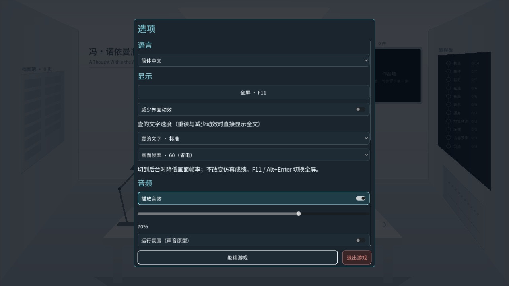 |
| 第一章：标题「第一章 · 时间的去处 / 1-1 三器相连」，标题栏无全屏/反馈按钮 | 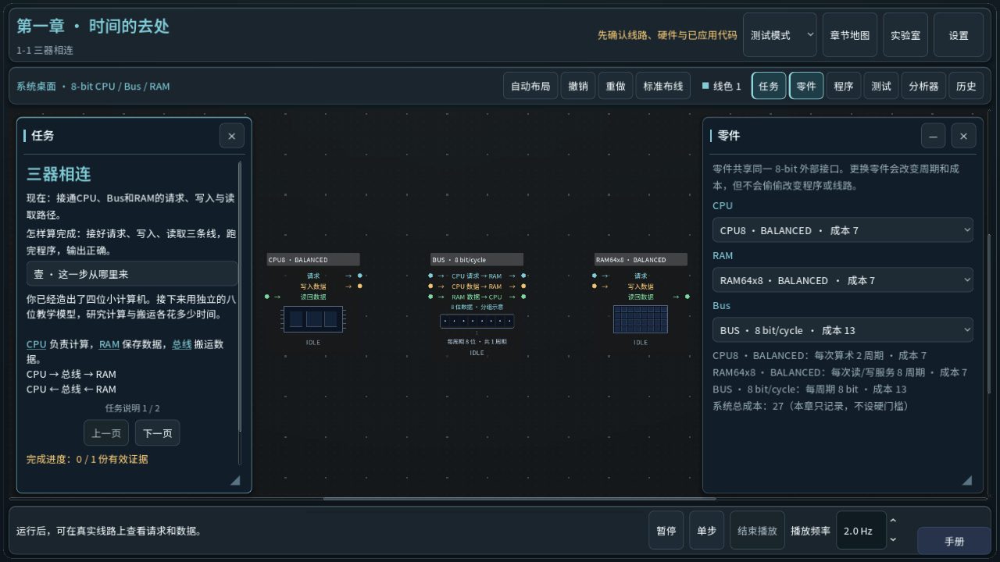 |
| 第三章：电路取景到任务窗与元件窗之间；返回按钮为「旅程地图」 | 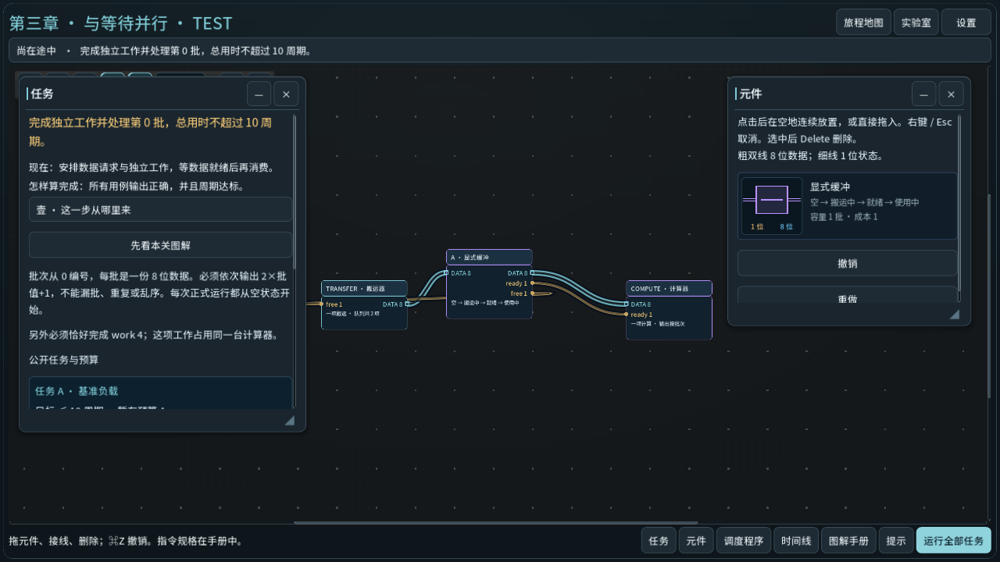 |
| 第四章：标题「4-1 只取所需」，原三栏与一次性任务卡保持 | 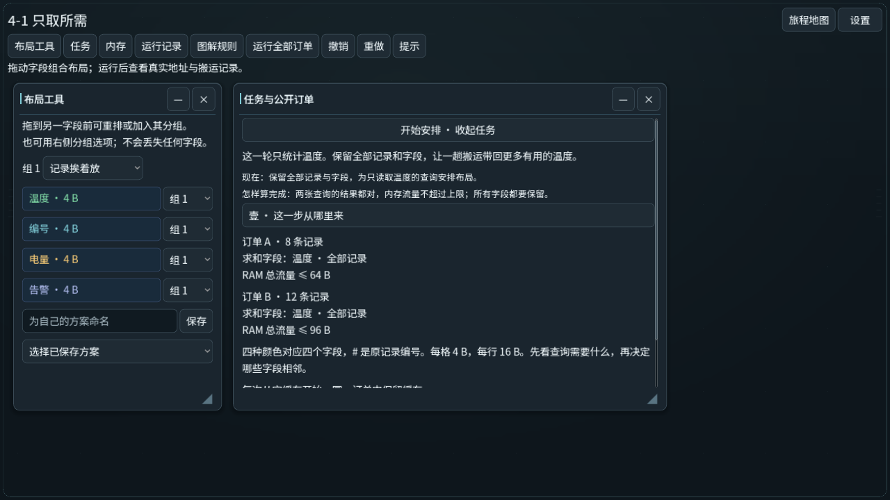 |

第三章截图拍摄于目标栏改用 `3-1 …` 名称之前；该改动由 `test_overlap_ui` 等套件回归，未重新截图。

## 自动验证

使用 `python -X utf8 scripts/verify-project.py --godot <Godot 4.7.1 console>`（每次隔离副本、独立用户目录）：

| 运行 | 结果 |
|---|---|
| 完整回归（178 个常规套件 + import + user_directory） | 176 通过，2 失败：`test_candidate_disabled_focus`（断言工作台标题栏的反馈按钮在 Tab 链中——本轮有意移除）与 `test_tree_journey_presentation`（英文下两行章节按钮过高，挤掉详情区可见范围） |
| 修正后重跑：上述 2 个 + `test_ui_convergence`、`test_task_tree*` | 全部通过 |
| 第三章目标栏改名后：`test_overlap_ui`、`test_overlap_simulation`、`test_full_journey_narrative` | 全部通过 |

此前另有一轮 24 个相关套件的定向运行，其中 `test_hub_first_screen` 因旧首页仍期待全屏按钮而失败，期望已按“全屏只在设置”更新，完整回归中通过。

新增套件：`test_yi_typewriter`（28 项：换行/显式换行/跳过/重读/减少动效/隐藏/素材选择）、
`test_ui_convergence`（57 项：命名、终端、设置、工作台按钮、求助小卡、步骤卡、完成卡）。

## 未验证

- 人工键鼠与陌生玩家试玩；Mac；高 DPI / 全屏下的光标清晰度。
- 英文界面只截了终端；其它英文界面由自动测试覆盖排版。
- 离线测试者包中工作台反馈按钮的保留行为只经代码检查，未导出包验证。
- `test_recovery_game_input`（仅 `--gui` 运行）本轮未运行。
