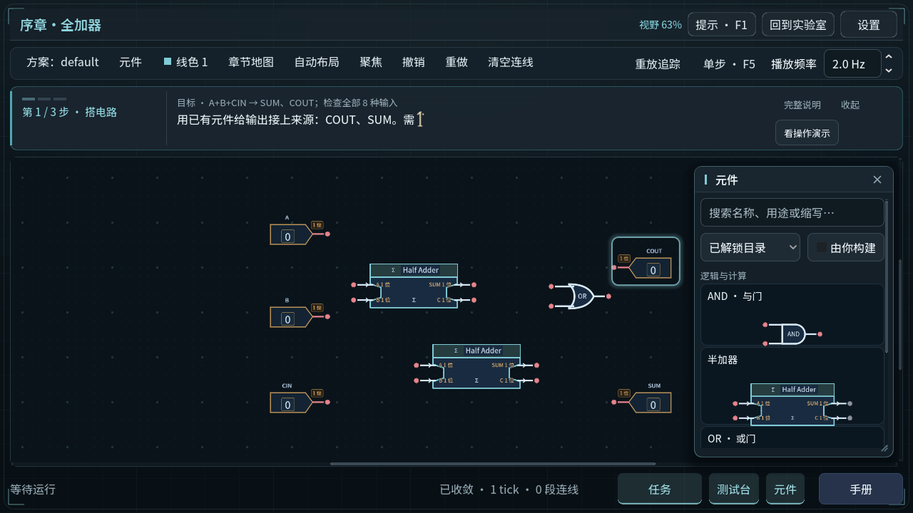
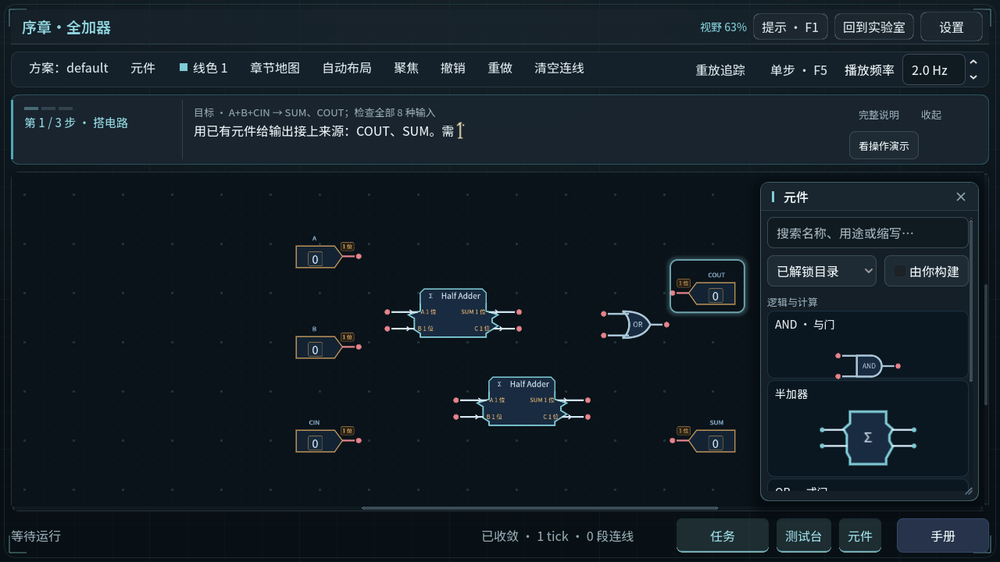
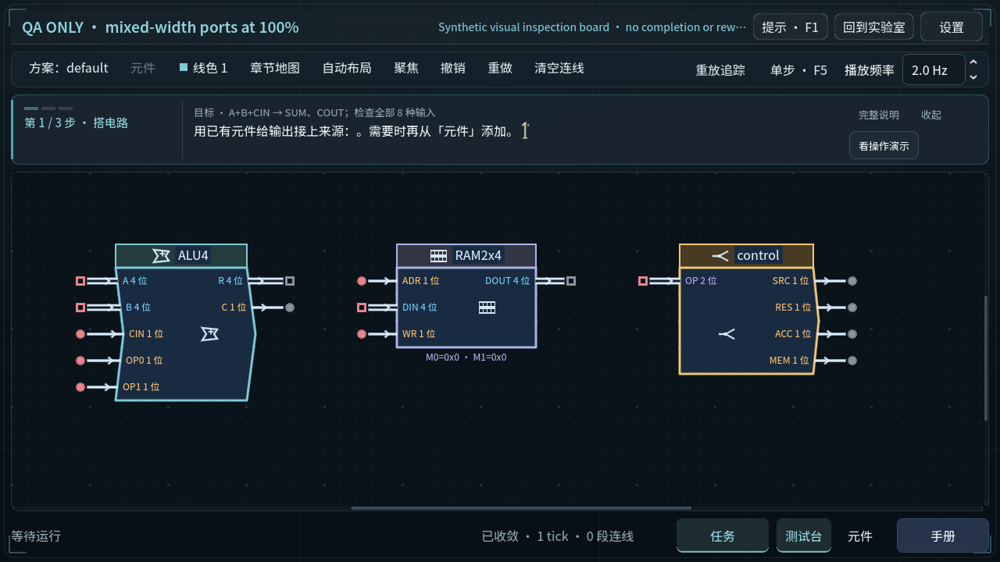
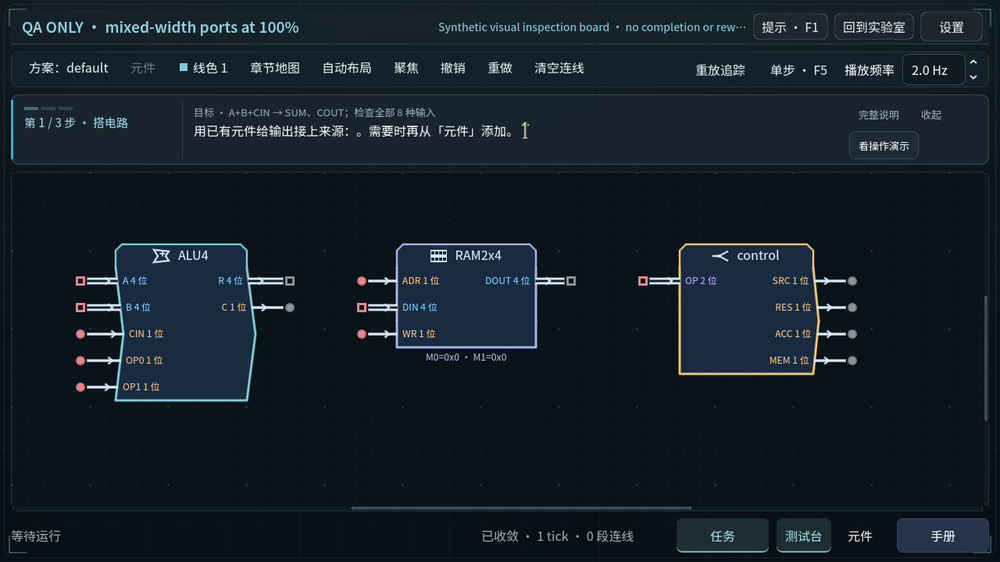
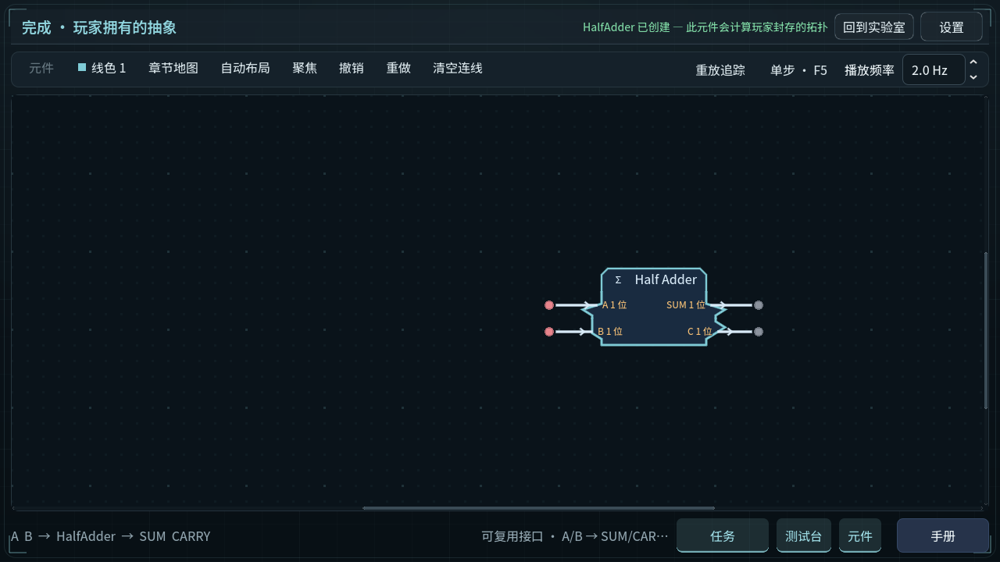
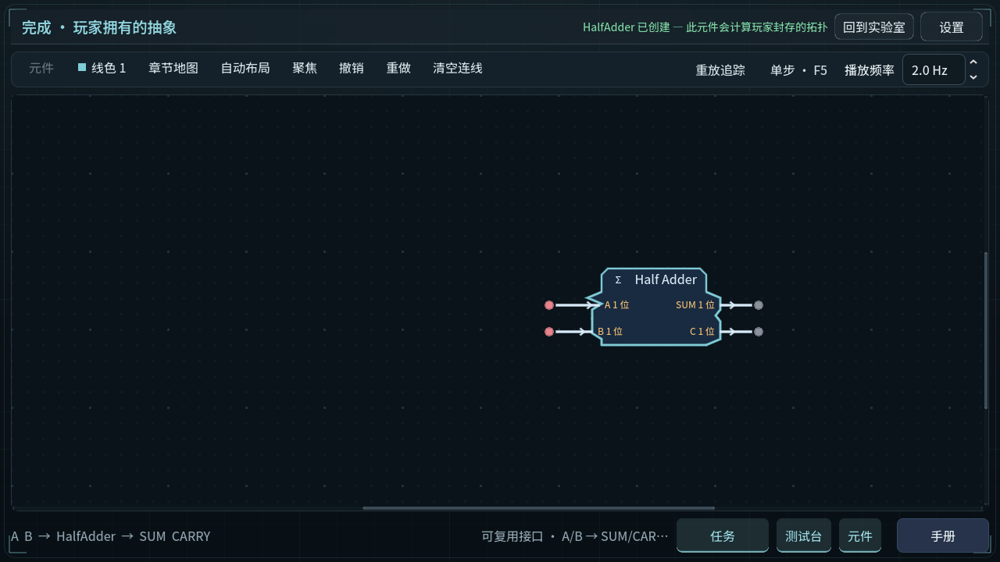

# 元件重构 · 真实游戏前后对照

[打开完整对照图库](index.html)。20 组前后对照，共 40 张未经重绘的 1280×720 游戏截图；点击图片可查看原尺寸。

## 最终行为

- 23 类逻辑对象和 CPU／RAM／Bus 复用现有程序绘制、家族颜色、真实接口与信号语言。模块标题与端口区连成一个外壳，只保留一处功能图标；四位寄存器具有四格图标。
- 元件栏的多端口模块使用已有完整模块缩略绘制，显示真实引脚数量、位宽和冻结轮廓；完整端口文字保留在画布及提示中。放置预览保持完整 GraphNode 几何。
- 正式封装冻结实际内部元件的位置和稳定画布占位；外部测试端子不参与外形。新封装使用保持长宽关系的 V2 格点包络，旧 V1 保存的 bands 不重新生成。重排当前散件不会改写已封装记录；再次封装才生成新记录。
- 封装完成页、后续复用节点与元件栏读取同一冻结记录。无布局、无效数据、来源不符或自动派生元件保留家族回退，不补造手工成果。
- CPU 计算、等待和 RAM／Bus 读写来自真实事件。多位常量显示真实数值与位宽，长值使用测量后的安全文字区。

端口键、索引、位宽、模型、验证、依赖和规范签名未改；存档格式未换。11 个核心契约文件与基线保持一致，见 [源码与验证快照哈希](source-manifest.json)。

## 代表画面

| 元件栏与画布 · 重构前 | 元件栏与画布 · 重构后 |
| --- | --- |
|  |  |

| 混合位宽 · 100% · 重构前 | 混合位宽 · 100% · 重构后 |
| --- | --- |
|  |  |

| 经正式封装的布局一 | 同功能、另一摆放经正式封装的布局二 |
| --- | --- |
|  |  |

图库另含 26 类覆盖、密集 ALU／RAM、65%／100%／135% 接线以及实际系统计算、等待、读写状态。

## 数据来源与玩家边界

重构前为 `30a92f8`；重构后为当前工作区，具体字节由哈希清单和两份截图回执标识。引擎为 Godot 4.7.1 stable，Windows NVIDIA RTX 5070 Ti Laptop GPU，OpenGL compatibility。

两种半加器来自**隔离 QA 玩家配置**中的工作台：建立实际连接、跑完四组正式用例、触发现有封装操作、等待封装结束，再用独立 GlobalSave 实例重载并重新验证原始来源。没有调用夹具安装接口授予半加器；教程前置仅为显式 QA 访问设置，不是玩家通关证据。

类型总览和密集板是明确标注 QA ONLY 的合成检查画布，采集前关闭持久化。系统画面使用独立 Test 模式。附件中的样例、作品卡和素材包均未安装到正常玩家成果；正常玩家存档未用于验证。此处不宣称使用了真人既有作品，也不代表原生键鼠试玩或新人理解验收。

附件 SHA-256：`e09a82e14b6fe237894d5a63345dd7e159274f70a4b1d23cb50dcaa26d9317cb`。其 SVG／Python 仅作候选参考；游戏运行不增加 Python、AI 或网络依赖。

## 新鲜验证结果

| 检查 | 结果与证据 |
| --- | --- |
| 最终相关复测 | **9 套测试 + 2 项导入／隔离检查，11/11 通过**：[结果](final-focused/results.json)。覆盖真实端口、常量 1～32 位、封装、旧数据重载、来源回退和系统事件。 |
| GPU 对照 | 前、后各 **223 项检查、20 张图、0 失败**：[前回执](before-receipt.json)、[后回执](after-receipt.json)。原始 PNG 哈希、运行源码哈希、正式验证报告和冻结记录均在回执中。 |
| 冻结与重启 | 两次同接口封装的来源签名相同、bands 不同；重载后轮廓坐标和摘要一致。移动外部测试端子不改变新封装外形，移动内部元件会改变外形。 |
| 仿真一致性 | 前后实际系统调试均通过，完整轨迹摘要、输出和指标一致：22 总周期、20 等待周期、2 次内存请求、2 字节搬运。图库构建器逐项比较，未仅比较最终数值。 |
| 全量回归 | **219 阶段：216 通过、3 失败**：[原始结果](full/results.json)。包括 217 套 Godot 测试及两项导入／隔离检查；不含独立 GUI 输入回放。 |

全量快照之后的最终修改仅为：将真实处理状态传给唯一保留的模块标题图标，并区分四位寄存器图标。上表的 11/11 是该最终源码的复测；截图回执中的源码哈希与当前文件一致。

全量失败没有隐藏或改成通过：

- `test_immersive_lab`：400 项断言通过，但出现已释放 lambda 捕获的引擎错误；未修改的 `30a92f8` 基线亦复现。
- `test_lab_terminal_routing`：全量在 Map Esc 路由失败；未修改基线单独执行在 Layout Esc 失败。这证明该套存在既有路由／时序不稳定，不宣称两次失败点相同。
- `test_terminal_language_input`：全量在返回实验室的场景类型读取处失败；未修改基线和最终源码单独重跑均通过（65 项检查）。保留为全量中的非稳定失败。

见 [基线对照结果](baseline-checks.json) 和 [最终语言重跑](current-extra-checks.json)。实验室代码未在本轮修改；本轮不宣称全量全绿，不包含新安装包、全 60 关人工通关或性能基准。

## 复现入口

相关测试使用 `scripts/verify-project.py` 的隔离副本。图形采集使用 `scripts/capture-component-refactor.gd`，要求真实显示后端、全新且明确命名的 QA 自定义用户目录，并传入 `--phase=before|after --evidence-dir=绝对路径`。不能在正常玩家配置运行。

`accepted-before-final.txt`、`accepted-after-final.txt` 保存实际 GPU 后端及完成记录；原始测试日志分别位于 `full/`、`final-focused/`。源码改动留在工作区，未提交 Git、推送或发布。
