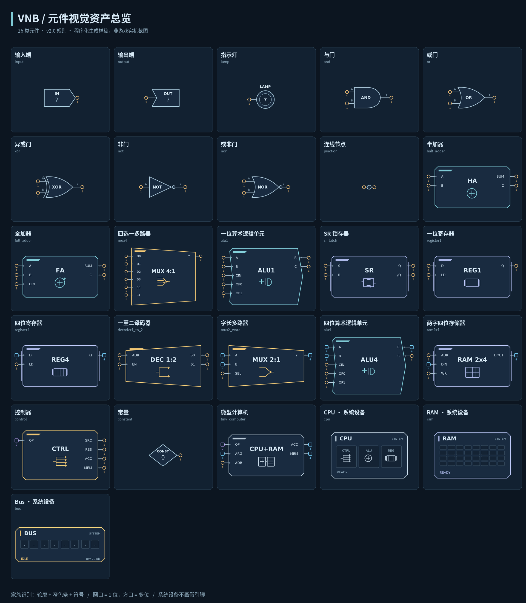

# 用户参考形状接入 · 2026-10-22

视觉目标为用户再次确认的 `01_all_components.png`，与 ZIP 中同名预览字节一致，SHA-256 为 `a4c3023994d911f9664e6e53aa75da6d150a22bef9b82ed35d9d159eadb72dcb`。

## 最终规则

| 对象 | 本体外观 |
| --- | --- |
| 输入／输出／灯／常量／节点 | 右向标签、左侧内凹标签、同心圆灯、菱形常量、小圆节点；保留真实数值及位宽 |
| AND／OR／XOR／NOT／NOR | 保留逻辑门语义轮廓、反相圆与 XOR 附加弧线 |
| HA／FA／CTRL／微型计算机 | 完整切角主体；中央一个短名称，下面一个功能符号 |
| MUX／译码器／ALU | 收束与展开的相反梯形；ALU 使用参考图中的八点凹口轮廓 |
| SR／寄存器／RAM2×4 | 小切角、细侧轨、记忆单元／寄存器列／存储网格 |
| 系统 CPU／RAM／Bus | CPU 的 CTRL／ALU／REG 分区、RAM 网格、Bus 横向通路；现有主机真实接口与硬件参数保留 |

基础颜色、细线和家族色条统一。模块不再把名字放在单独的顶部标题块，也不在每个端口行重复画功能符号；实际 CPU 电路中的 SRC MUX、RES MUX、ACC 保留角色区分。行式控制器继续承载真实端口，绘制时各行切分同一个完整主体，最后一行绘制中央标记；命中、引线与填充共享同一轮廓。

元件台、放置预览、画布使用同一构造器。已有玩家冻结 bands 优先于内置家族壳，不重新生成；冻结轮廓不加内置色条和侧轨，端口文字在轮廓外侧上移，保留中央名称／图标空间。模拟、来源签名、真实端口索引与位宽、存档契约不变。参考图中的示例数值、引脚位置和作品不安装为玩家成果。

## 新鲜验证

[最终结果](final-headless/results.json)：Godot 4.7.1 stable，隔离运行 `20261022T154454Z-e0f503ac`，**11 套相关测试 + 导入／目录隔离检查，13/13 通过**。

- 参考设计 **1228 项**：明确核对 ALU 八点、多路器／译码器相反梯形、控制器切角、家族切角尺寸、色条位于壳内、行切片无接缝、中央名称／图标次序与最小字号、冻结采样保留。
- 基础符号 **32 项**：输入凸标签、输出凹口、节点圆形命中、真实引线、门类身份。
- 元件台／预览／真实 GraphEdit 一致性 **508 项**：23 类逻辑对象、多位宽常量、两种不同的来源绑定冻结形状。
- 元件边界、真实接口、放置操作、存档重载、完整硬件 UI、序章封装／CPU／LOAD-STORE、系统设备事件与系统页面通过。

[源码回执](source-manifest.json)绑定实际测试副本与最终源码，并确认此前 11 个模型、模拟、内容及存档契约文件哈希不变。

## 验收边界

仍遵照用户此前要求，**没有打开游戏窗口、没有新增 GPU 截图**。上方图片是用户参考；上述通过项为几何、数据及页面结构检查，不宣称已完成实际游戏中的视觉相似度、原生操作或新人辨识验收。没有重新运行全量套件；此前实验室跨场景问题保留独立记录。未提交 Git、推送、发布或导出新包。
