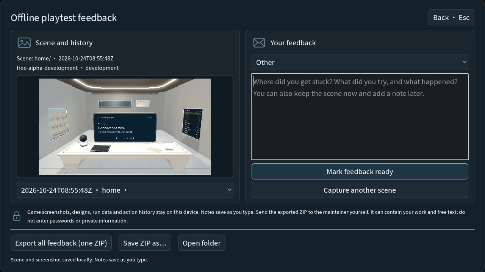

# 赛后调研：即时改进（2026-10-24）

参考用户提供的《赛后发展研究资料包》，仅采用可由当前实现确认的问题。
资料包 SHA256：`8b28ef4aca22e067447b418fdb39228ee8326ffe8c72928f7dcb7c64b8f0827a`。
基础为 `739118f` 加已保留的本地改进；本记录只描述本轮增量。

## 已改

- 离线反馈显示任务标题、内部任务 ID、捕获时版本与短提交号。回看历史不借用当前构建身份；语言切换不重置文字。
- 普通反馈显示已有提交身份；未改动的历史意见显示其保存事件的身份，编辑后显示当前任务身份，不改写旧事件。未配置接收端时禁用发送，并直接说明本地保存与导出仍可用；已配置端点的离线重试入口保留。采集范围与保存格式未变。
- 地址预测英文明确只有完整运行才记录测量；现有机器说明使用“简化模型 / Model costs”。周期规则与结果未变。
- 中英文 README 明示链接为 10 月 17 日固定离线版，区分当前开发源码和单独冻结的比赛包；保留源码运行入口。当前离线试玩说明的教程成果位置更正为地球仪。

## 未改

- 没有生成或公开发布新试玩包、替换比赛提交物。下载入口已标清版本，新的可下载版本仍待独立交付。
- 没有新增 15–20 分钟精选路线、跳关或新教学单元；需确认选题与真实新玩家流程。
- 没有继续重排后期工作台：现有目标、运行和结果分区已具备，尚无新增观察支持大改。
- 没有新增方案对比平台、更多章节、CG、在线 AI、账号或课程后台。
- 没有招募试玩者、联系导师、报名、自动采集新数据或宣称教学效果；资料中的外部计划不作为本轮软件任务执行。
- 个人技术案例、正式研究问题与对照实验仍需本人及导师参与；现有模型规则和说明保留。

## 核验

Godot `4.7.1.stable.official.a13da4feb`，隔离项目及 APPDATA/LOCALAPPDATA，无玩家存档。
原始四项检查见 [results.json](results.json)：反馈首屏、离线反馈、设置与反馈布局通过；地址预测首轮英文过长导致 720p 工作台高出18px，原始失败保留在日志。
压短英文后，[地址预测最终检查](prediction-final.txt) 1293 项、0失败；未放宽原有布局断言。
最终普通反馈[身份与跨版本草稿检查](feedback-context-final.txt)通过；文本编辑时只刷新身份，不重新读取任务树。GPU 重放 [设置/反馈布局](gpu-feedback-final.txt) 160 项、0失败；人工查看中英文普通及离线反馈的实际引擎画面，关键控件完整。

另通过 Windows Computer Use 在实际 GPU 窗口中打开/关闭反馈、切换窗口模式、经设置切换英文并重新打开反馈，确认无接收端说明与禁用按钮；演示启动器使用隔离 QA 场景，来源仍标记 automated，不作为真人陌生试玩。演示正常退出0，见 [native.txt](native.txt)。
未进行网络发送、全60项旅程、声音或跨设备/新导出包验收。只有两项现有反馈测试补充了身份、草稿保持与端点可用性检查。

比赛 ZIP 重新核对保持 `e4316e56389f216a6d9f3fa516393aadc726eebae3674764920d827696058b4f`。
既有改动保留，无提交、推送或发布。增量文件核对见 [scope-audit.json](scope-audit.json)。

