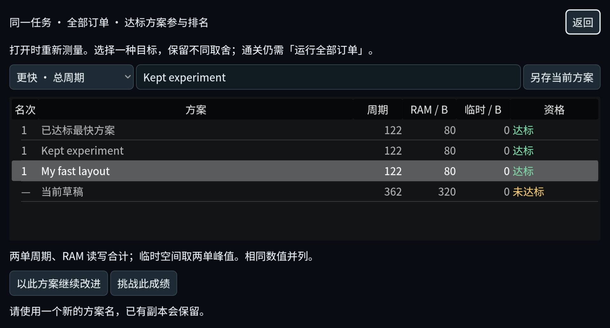
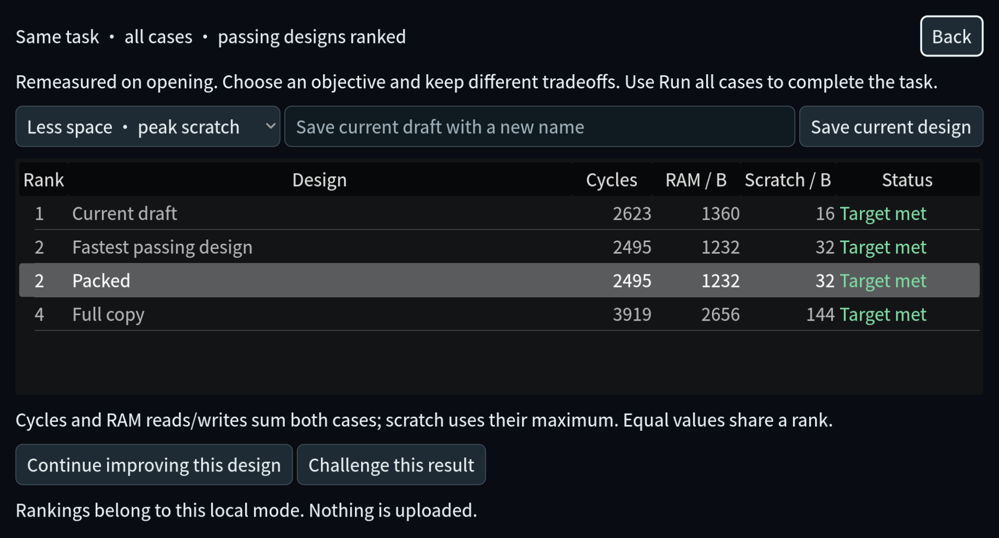

# 游戏系统首轮可玩增量 · 2026-11-04

基线 `b65a0bd`，开发分支 `codex/gameplay-systems-20261104`。本轮为本地源码
增量，未提交、推送、打包或发布。`main` 与本地 `origin/main` 引用仍为
`b65a0bd`；没有以网络查询重新认证远端。现有 60 项旅程、模拟规则、任务
判定、成果与存档结构保持。所有运行使用复制的工程和独立 QA 数据目录。

## 可玩入口与行为

第四章任一任务顶部打开 **我的方案榜**。当前草稿、已经获得的最快达标方案
和玩家命名方案都由当前模拟器重新执行全部订单；不会向玩家榜单注入提示
答案。选择周期、RAM 流量或临时空间目标，保存一份方案、恢复一份方案继续
改进，或设为本次工作台访问内的个人挑战，再运行全部订单比较。

- 周期与 RAM 读写量分别合计两单；临时空间取两单峰值。
- 全部原任务要求达标后才有名次；失败、超空间、正确但未达标均不排名。
- 同分并列 `1、1、3`，不制造综合分。挑战必须严格改善所选指标，平手不算胜。
- 恢复方案可撤销，旧运行失效，必须重新测量。查看、排序、钉住目标不授予成果。
- 命名方案沿用原存档；挑战目标是本次访问内的临时状态。Game/Test 始终分离。
- 写盘失败保留内存副本并显示现有恢复窗口；同名同配方可重试，不同配方不会
  覆盖已有副本。
- 切换目标只重排当前测量快照；重新打开或保存会完整复算。

电路工作台的方案菜单新增 **复制当前方案…**，保留元件、接线、布局和颜色，
先成功保存原方案再进入副本；副本必须重新测试。服务工作台的多组合并撤销/
重做恢复完整选择和活动组。第二章前后比较隔离 Game/Test 与重复遍数，并
遵守已有诊断信息门槛。第四章详细成绩中的损坏文字已修复。

可在隔离副本的实验室终端选 Test，通过旅程地图直接检查第四章；正常 Game
仍遵守现有前置条件。源码普通启动会使用正常玩家目录，开发验收应继续采用
下方隔离流程。

## 真实策略取舍

下列都是 `mixed` 的两张官方订单，同一模型、相同任务约束；三个方案均达标。
这里的参考配方仅用作自动验收夹具，没有注入实际玩家存档或榜单。

| 策略 | 总周期 | RAM 读写 / B | 临时峰值 / B |
| --- | ---: | ---: | ---: |
| 全量复制 | 3919 | 2656 | 144 |
| 分批 4 条 | 2495 | 1232 | 32 |
| 分批 1 条 | 2623 | 1360 | 16 |

较小临时空间确实需要更多周期与搬运；玩家可以保留不同目标的方案。
另一个独立例子 `fields` 按字段相邻排列时，A/B 分别为 49/73 周期，
32/48 B，总计 122 周期、80 B；初始方案则是 362 周期、320 B，正确但未达标。





[英文资格状态画面](layout-scores-en.png)。图片为真实 Mac GPU 原始帧；
测试方案名是夹具名称。中文/英文图底部的重名拒绝说明来自覆盖保护检查。

## 验证结果与身份

引擎 `4.7.1.stable.official.a13da4feb`，macOS / Apple M2，GPU 使用
OpenGL Compatibility。最终运行代码、测试和依赖的 18 个文件与最终隔离
工程 SHA-256 相符；`project.godot` 仅有两个隔离用户目录设置差异。
见 [源码身份](source-sha256.json)。

23 套不同的相关检查分阶段末次均通过，**不是同一最终快照的一次全量运行**。
[逐套末次结果](latest-suite-results.json)保留每套来源；
`runs/` 中保留原始结果与完整日志，包括中间失败。

| 验证 | 最终结果 | 来源 |
| --- | --- | --- |
| 计分模型、条件/配方身份、JSON 往返、确定性、并列、目标重排 | 37 checks PASS | `20261104T192942Z-290abb30` |
| 榜单、挑战失败/平手/获胜、空间目标、Undo、模式隔离、真实写盘失败与按钮重试 | 44 checks / 0 failures | 同上 |
| 同一 UI 套件的真实 Mac GPU 与 3 张截图 | 47 checks / 0 failures | [GPU 日志](gpu-scoreboard-final.txt) |
| 电路复制、真实半加器 Trace、原图保护、重开、失败写盘、模式隔离 | 44 checks PASS | `20261104T190535Z-d73a6de8` |
| 服务多选、合并/拆分、容量、Undo/Redo | 124 checks / 0 failures | 同上 |
| 第二章比较条件/诊断门槛、Mac 设置键盘恢复 | PASS | 同上 |
| 其余相关模拟、导航、配方来源、Trace 存储、GlobalSave、语言、工作台保存、服务操作、预测来源 | PASS | 见逐套结果 |

中间发现并修正：

1. Mac 基线复现预测断言 1/28、服务撤销 16/96 失败。预测测试需断言中文标签；
   服务旧 helper 应发送实际 `multi_selected` 信号，另修复完整多选历史。
2. 新独立模型测试静态预载状态 autoload 导致 `GameMode` 编译错误；核心改为
   依赖纯模拟校验。电路 UI 测试的静态场景预载也改为 autoload 就绪后加载。
3. JSON 往返暴露返回配方未归一化，现返回归一化深拷贝。
4. 原设置测试固定 Ctrl+Z，Mac 应使用 Meta+Z；仅改测试注入。
5. 独立复审发现写盘失败后的榜单重试会被同名保护拦住，已修复并通过实际按钮路径。

最终两次独立只读复审见 [交互复审](vnb-final-interaction-review.md)、
[排序与重试复审](vnb-final-ranking-review.md)；[此前发现重试问题的记录](vnb-final-score-review.md)
保留以说明修复来源，不代表仍有未解决的该项故障。

## 原生输入观察

在 `20261104T190535Z-d73a6de8` 的隔离副本中，使用原生鼠标/键盘操作，
而非脚本发按钮信号。第一段实际选择“相同字段挨着放”、运行并查看 A49/B73
以及 122 周期/80 B 的榜单。第二段从初始方案运行，输入并保存 `Native A`，
观察到两个 362 周期/320 B 的未达标条目，点击“返回”回到工作台。

第二段尝试用 Down/Return 改布局没有成功，实际仍是初始方案；没有将它计作
成功的布局选择。操作工具一度超时，后来通过新截图和模型输出确认保存成功。

[原生运行数据](native-gameplay-result.json)、
[原生保存画面](native-gameplay.png)、
[初始化/观察脚本](native-gameplay-probe.gd.txt)、
[对应源码身份](native-source-sha256.json)。
该脚本只打开 Test 的指定任务、观察命名后的结果并截图，不输入方案答案。
原生记录发生在最后的短状态文案、同名重试与排序优化之前；最终改动另外由
上述 GPU/UI 检查覆盖，不把较早原生操作扩大为最终全部功能的原生验收。

## 容量测量

[探针](score-capacity-probe.gd)覆盖 6 个任务、4 种夹具库，每库 26 个候选
（24 个命名方案 + 当前 + 最佳），分别测量 3 个目标，共 72 次。每个夹具库
使用同一配方的不同名字，包含未达标/非法策略库；不是任意配方的穷尽最坏情况，
也不是 UI 帧时间或跨设备性能承诺。

本机完整复算最大 **612.281 ms**；对已经测量的 26 行重新排序最大
**0.314 ms**。因此切换目标复用本次测量，避免无意义的重复仿真；
打开/保存仍重算，较大方案库可能有约半秒等待。没有添加不稳定的时间断言。
见 [原始测量](score-capacity.json)和[运行日志](score-capacity.txt)。

## 复现与边界

主线程独占 Git mutations 和 Godot 运行；子 Agent 分别审计/实现后归还文件，
再独立复审。以下命令会复制源码并按套件创建隔离玩家目录：

```sh
python3 scripts/verify-project.py \
  --godot /Users/yrq/Applications/Godot-4.7.1.app/Contents/MacOS/Godot \
  --suite test_layout_scoreboard --suite test_layout_scoreboard_ui \
  --suite test_workbench_duplicate --suite test_service_undo_context \
  --suite test_locality_trace_presentation --suite test_prediction_record_source \
  --suite test_chapter_settings_input
```

GPU 与容量探针只在验证器生成的副本中运行，并设置新的
`VonNeumannBottleneckChecks/...` 自定义用户目录。具体 GPU 参数见
[测试指南](../../development/testing.md)。所有测试产生的数据均为 QA 夹具；
没有访问或修改真实玩家档。

未完成的验收：整仓全量回归、Windows/Linux 新运行、独立导出包、完整新手
通关、听感、长时间游戏，以及全部电路复制/服务多选操作的原生鼠标验收。
本轮没有在线榜或服务端可信成绩；本地复算不等于防篡改。

上一轮争议设计及后续系统优先级在
[接手审计](../../development/GAMEPLAY_AUDIT_20261104.md)。回退本轮功能只需撤除
新增比较入口/读取器及局部编辑功能；保存的命名方案仍是原结构，无存档迁移。
不删除玩家数据来回退。本轮计划已完成，长期系统开发目标继续有效。
