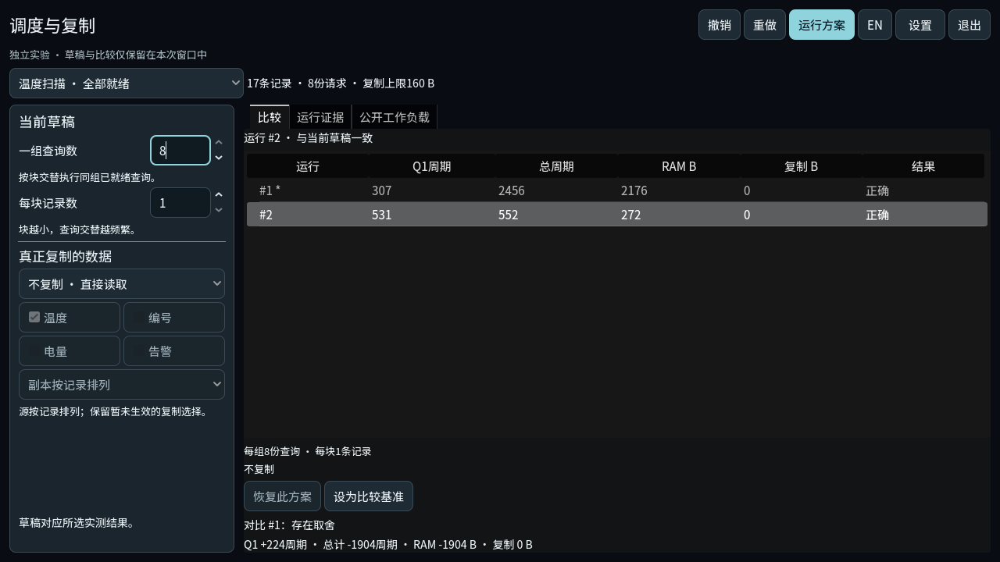

# 独立调度与复制实验台 — 2026-11-04

第四轮已交付可玩的独立实验：玩家分别控制查询分组、记录分块和真实复制，
运行后比较首个请求响应、总周期、RAM 流量及复制空间，并查看实际事件。
它保留四种工作负载各自的草稿、历史、比较基准和可撤销恢复。新模型
`layout-schedule-experiment-1` 不接入正式旅程、成果判定、存档或旧挑战码。
原第四章 `layout-memory-1` 的合法方案及成绩保持有效。

本轮在分支 `codex/gameplay-systems-20261104` 上完成，起点为
`b65a0bd3064888f41c5caeb8d7d0717d2b901658`，沿用 Godot
`4.7.1.stable.official.a13da4feb`。证据目录日期为 Mac 当地11月4日，
部分调用的 UTC 时间已是11月5日。用户随后授权重大更新提交并推送独立
分支；不授权合入 main、导出或发布新版本。前三轮证据仍分别保留：
[个人方案榜](../20261104-gameplay-systems/README.md)、
[同条件记录与草稿恢复](../20261104-comparable-records/README.md)、
[可保存与分享的挑战](../20261104-portable-challenges/README.md)。

## 试玩

本机快捷入口为 `.godot/layout-scheduling-preview-20261104.command`，
启动最终 QA 工程
`.godot/verification/20261105T005513Z-6cc70bb5/project`，
使用独立目录 `VonNeumannBottleneckChecks/20261104-round4/playable-preview`。
普通启动直接打开实验台，没有测试驱动、预置胜出成绩或 capture 参数。
实验草稿和历史在退出后丢失，退出确认会明确提示。

从任意当前源码副本重新准备隔离实验：

```sh
python3 scripts/run-experiment.py layout_strategy --godot /path/to/Godot-4.7.1
```

加 `--locale en` 可用英文，`--prepare-only` 可只准备工程；该副本的 F5
直接进入实验。原仓库 F5 仍打开完整60项旅程。不要将实验场景直接用于
普通玩家目录；新入口不接受旧实验的 profile/journey/replay 组合。
规则、操作与兼容说明见[实验 README](../../../experiments/layout_strategy/README.md)。

## 真实策略取舍

生产模型运行595组声明组合，其中385组来自四个可玩工作负载，210组来自
额外的16请求探测；另有90次重复或JSON往返执行。所有输出、因果关系、
成本核算及选中完整 Trace 重放通过。四个可玩条件在此有限样本中分别有
4、2、5、2类非支配指标向量；这不是595种不同物理策略，也不是全局最优。

| 同条件方案 | Q1响应周期 | 总周期 | RAM字节 | 峰值复制字节 |
| --- | ---: | ---: | ---: | ---: |
| 同时到达温度请求：默认逐单读取 | 307 | 2456 | 2176 | 0 |
| 同时到达温度请求：8查询一组、1记录一块，不复制 | 531 | 552 | 272 | 0 |
| 逐单到达温度请求：默认读取 | 307 | 2456 | 2176 | 0 |
| 逐单到达温度请求：保留温度字段副本 | 557 | 1362 | 980 | 80 |

Q1指公开顺序中的第一份请求，不是最早完成的任意请求。准备副本的实际
读写代价计入等待；复制峰值不含累加器和输出存储。响应紧随真实最后输出，
没有附加调度罚时、假分数或缓存重置。[采样范围、公式与原始结果](strategy/README.md)。



## 自动与图形验证

所有 Godot 调用顺序执行，使用复制工程及独立 QA 数据目录。
[初始完整结果](logs/initial-focused/results.json)记录导入、目录探测和18套
相关检查全部通过。另加实验 UI 的末次分阶段结果，共19套不同相关检查；
这不是一次最终全仓库回归。

| 范围 | 实际结果 | 原始日志 |
| --- | --- | --- |
| 实验模型 | 2669检查、171次测量、0失败 | [model](logs/initial-focused/test_layout_strategy_model.txt) |
| 会话/历史/恢复 | 35检查、0失败 | [session](logs/initial-focused/test_layout_strategy_session.txt) |
| 正式模型冻结对照 | 3810检查、141设计、282正式用例、0失败 | [legacy](logs/initial-focused/test_layout_strategy_legacy.txt) |
| 最终无头实验界面 | 214检查、0失败 | [headless](logs/headless/20261105T014628Z/test_layout_strategy_ui.log) |
| 最终 Apple M2 OpenGL 界面 | 242检查、0失败 | [GPU](logs/gpu/20261105T014640Z/test_layout_strategy_ui.log) |
| 最终普通主场景启动 | exit0、无诊断；无测试驱动 | [调用](logs/startup-smoke.json) · [日志](logs/startup-smoke.log) |
| 实验启动边界 | profile/journey/replay三种不支持路线均在启动引擎前拒绝 | [结果](logs/runner-guards.json) |
| 生产策略网格 | 595组合、90重放、0失败，12.770009秒 | [调用](strategy/20261105T005822Z/invocation.json) · [日志](strategy/20261105T005822Z/grid.log) |

初始相关检查包括原布局模拟、导航、配方源、Trace保存、界面、预览选择，
方案榜及其界面、挑战码/存储/控制器/窗口、章节设置、GlobalSave及本地化。
旧规则对照比较完整规范 Trace、输出、全部指标、身份和达标资格；共享改动
仅提取查询值与输出操作，未改变成本或正式规则版本。

实验界面检查执行真实运行、历史键盘选择、显式比较/恢复、配方和文字撤销、
语言及工作负载切换、失败运行、旧测量标识、F8/F10及退出焦点恢复。
初期发现并修复 TreeItem 发选择信号时删除自身的崩溃、退出层经设置语言
重建后焦点落到背景编辑器，以及英文最小尺寸的间距溢出。失败日志全部保留，
没有通过放宽核心断言接受失败。

最后捕获发现两张命名1280的中文图实际上为2940×1846。
[首次尺寸断言失败](logs/gpu/20261105T013713Z/results.json)及
[仅加窗口参数仍失败](logs/gpu/20261105T014422Z/results.json)均保留。
最终夹具在场景建立后调整尺寸，连续检查真实 Image 尺寸，不仅检查纹理
元数据，并使用 windowed 启动。12张最终原图均为声明的1280×720或960×640，
保存返回值与尺寸检查均通过；没有缩放图片补救。原先12张图留在
`diagnostics/initial-gpu-20261105T011406Z/`，只作历史诊断。
[图像哈希、尺寸与来源](frame-sha256.json)绑定两组图片。

1170个源代码、测试及支持文件与最终 QA 工程逐字节一致；
[源码清单](source-sha256.json)记录双方 SHA256。QA `project.godot` 仅增加
两个隔离目录设置并替换实验主场景。七个新GDScript的UID来自实际导入。
本地启动器通过 `zsh -n`，普通启动检查在同一最终工程完成。文档更新不
改变受测模型和界面。旧三轮预览导入缓存的恢复另有
[实际恢复收据](recovery/20261105T005116Z/results.json)；无完成收据的早期
APFS克隆尝试不作为成功证据。

[提交前静态记录](static-checks.json)保留完整暂存检查的边界：源码及手写
文档空白检查通过；原始引擎日志有9处尾空格/末尾空行提示，逐一限定到
原始输出文件，保留其字节而未为消除提示改写日志。源码/图片哈希再次
匹配，远端main在推送前仍是起始基线。

## 原生操作与验收边界

CUA 原生鼠标/键盘实际观察了默认运行、设比较、编辑8/1、再次运行、查看
历史、恢复、Cmd-Z、主界面语言切换及退出保护。第一进程误带 capture
参数，设置语言时出现既有“禁止写入”对话框；这不算普通设置无警告验收。
第二个正常进程可启动、运行并打开退出层及设置，但语言下拉后 CUA 报
`noWindowsAvailable`，后续选择未证实，最后只终止了该隔离进程。
[逐步记录、两个调用及退出状态](native/README.md)分别保留，不能拼成
完整原生设置链通过。

原生普通设置下拉、导出包、Windows/Linux运行、真人新手、长时游玩及音频
仍未验收。本轮界面原生证据不替代第二/三轮当时因锁屏未做的操作验收。
在线成绩仍需要固定版本的服务端复算；本地结果不构成反作弊或远端可信榜。

独立报告见[模型](reviews/model-review.md)、
[网格与启动边界](reviews/grid-launch-review.md)、
[界面焦点修复](reviews/ui-recovery-review.md)及
[最终截图](reviews/capture-review.md)。
[最终证据审查](reviews/evidence-final.md)独立重算哈希、策略统计与覆盖数量，
未发现待修复的证据一致性问题。当前状态和下一阶段优先级见
[CURRENT_STATE](../../CURRENT_STATE.md)、
[设计审计](../../development/GAMEPLAY_AUDIT_20261104.md)及
[完成计划](../../exec-plans/completed/layout-scheduling-lab-20261104.md)。
