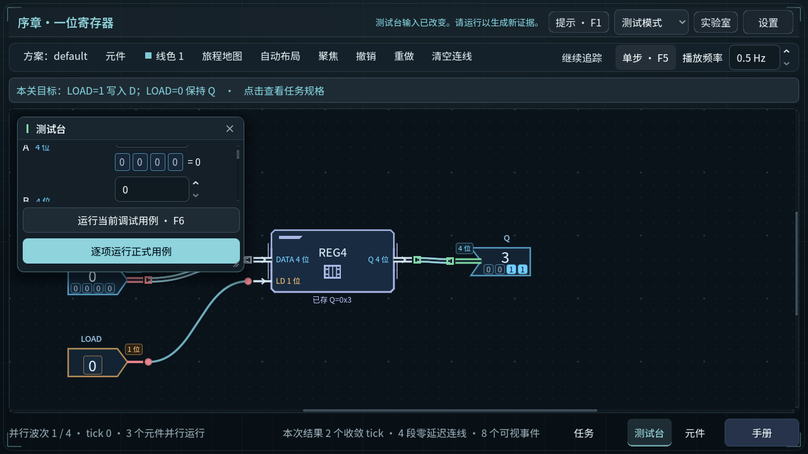

# 电路失败后的真实状态续接 — 2026-11-05

第十轮，任务分支`codex/gameplay-systems-20261104`，基线
`b765dd249cd165358dc5329480c529c76f9218bc`。本记录对应本轮源码与隔离QA，
不更新公开版本，不代表Windows或导出包验收。
[完成计划](../../exec-plans/completed/circuit-failure-recovery-20261105.md) ·
[计算审计](../../development/COMPUTATION_AUDIT_20261105.md)。

## 实际改动

修复序章整段及逐步运行的状态续接：先写入3，随后A5/B6驱动冲突，再把
两端改为0并HOLD，现在可以读回原来的3。失败的电气观察仍保留原输入、
冲突、输出、错误及全部事件；包含该失败的整段运行仍判失败。
`prior_outputs`只在最终电气求值有效时更新，不再把失败输出用于下一步。
这也保留原始反馈锁存器与封装锁存器的最后有效记忆。

电气有效但期望答案写错的步骤仍推进实际状态；已经在有效前置求值后提交、
却在提交后求值失败的存储也不回滚。输入编辑只预览，Debug提交边界，
Step只呈现已有事件。成功路径的求值顺序、成本、事件、64-tick上限、
线延迟和正式判定不变；没有存档、挑战码、成绩条件或模型版本迁移。
直接向独立`evaluate()`传入一个失败输出种子不属于本次修复。

实际图形核验还发现并修复一个相关显示缺陷：在旧WRITE回放尚未显示提交
边界时中断，再执行失败Debug，元件“已存值”可能遗留旧回放的0。
现在失败回放即使没有提交事件，也从报告的真实入站状态初始化元件标签；
标签显示3，失败现场仍可回放。该宿主改动只更新显示快照，不写仿真状态。

生产改动仅为`prologue_simulator.gd`的有效性门槛和
`hardware_foundations.gd`的失败回放标签初始化。GDScript仍是参考实现。
没有原生模块、依赖、工作负载、正式内容或成绩规则变更。

## 新旧完整计算对照

旧运行时独立从基线Git归档展开，556个`src/experiments`文件逐一绑定到
Git原始字节：[冻结清单](invocation-tools/round10-reference.json)。
新旧运行使用相同六份GDScript测量工具、相同Mac和固定Godot
`4.7.1.stable.official.a13da4feb`；每个场景三批固定次数。
[工具哈希](invocation-tools/round10-measured-gd-sha256.json) ·
[固定次数](invocation-tools/round10-iterations.json)。

| 数据组 | 旧版 | 候选 | 对照 |
| --- | --- | --- | --- |
| 11个原先有效场景 | exit0，0失败 | exit0，0失败 | 全部输入／结果／类型／状态／成本／事件精确一致 |
| 独立恢复诊断 | exit1，14条语义失败 | exit0，0失败 | 按预先声明的恢复差异逐字段检查 |

有效场景包括布尔正式／压力／诊断，以及序章全加器、ALU、锁存器、
寄存器、RAM、CPU、LOAD/STORE与压力组合。完整快照包含`tick`、
`visual_step`和`sequence_step`，不是只比较输出或一个摘要字符串。
[严格比较结果](invocation-tools/round10-valid-comparison.json)。

12个诊断成员中11个完全一致，只有“写入→短路→修正后HOLD”改变。
原写入与短路两步的完整观察及前25个序列事件保持一致；逐步短路报告
仅`prior_outputs`改变，准确等于入站有效映射。修正后的HOLD实际读回3，
其16个真实事件替换旧重复短路的6个事件，整段事件31→41；整段仍失败。
独立审查重算原始JSON、封存日志及24个完整快照的字节长度／哈希。
[差异审查](reviews/diagnostic-comparison.md) ·
[可复核脚本](reviews/diagnostic-comparison.py) ·
[检查结果](reviews/diagnostic-comparison.json)。

原始／封存JSON、完整日志、命令、返回码、隔离配置均保存在：

- [旧版有效语料](benchmarks/20261105T111531Z-reference-valid/invocations.json)
- [候选有效语料](benchmarks/20261105T112706Z-candidate-valid/invocations.json)
- [旧版恢复失败](benchmarks/20261105T111710Z-reference-recovery-defect/invocations.json)
- [候选恢复通过](benchmarks/20261105T112747Z-candidate-recovery/invocations.json)

这是正确性修复，没有本轮提速宣称。未改源码的布尔压力场景三样本中位数
观察到约5.9%较慢，其他有效场景中位数差异不足1%；全部原始范围保留。
旧失败诊断与新完成工作量不同，严格比较器拒绝为其生成可接受速度比。
宿主标签修复发生在该计算语料测量之后，模拟器与测量工具未变；
最终宿主源码由后续专门回归及GPU验证，不把前面的测量当作宿主验收。

## 回归、负向证据与图形检查

先证明测试能检出旧缺陷，再验候选。所有Godot进程由主线程顺序运行，
使用`VonNeumannBottleneckChecks/...`独立目录；普通玩家数据未参与。

| 阶段 | 实际结果 | 完整记录 |
| --- | --- | --- |
| 冻结旧版既有4套检查 | 全部通过 | [111336Z](checks/20261105T111336Z/results.json) |
| 新纯模型测试运行旧版 | 301项／31失败，exit1 | [112423Z](checks/20261105T112423Z/results.json) |
| 修正测试加载入口后的旧版宿主 | 124项／7失败，exit1 | [112522Z](checks/20261105T112522Z/results.json) |
| 候选标准验证器 | 13套通过，另有导入与隔离目录检查 | [candidate-standard](checks/candidate-standard/results.json) |
| 显示问题补强测试，宿主未修时 | 142项／2失败，exit1 | [113442Z](checks/20261105T113442Z/results.json) |
| 最终宿主及6套相关回归 | 宿主142项／0失败，其余全部通过 | [113619Z](checks/20261105T113619Z/results.json) |
| 最终中文GPU | 158项／0失败，exit0 | [113852Z](checks/20261105T113852Z/results.json) |
| 最终英文GPU | 158项／0失败，exit0 | [114010Z](checks/20261105T114010Z/results.json) |

13套不同相关检查的末次观察通过，不是全仓库回归。包括电路、序章、
纯恢复、宿主恢复、内容注册、全局存档、Hardware编辑／序章／封装导航／
入口、续跑、本地化与完整快照。纯恢复末次为308项／0失败，覆盖首次及
重复失败、错误期望、原始与封装锁存器、提交后失败、证据不被后续修改。

GPU使用Apple M2 OpenGL，1280×720；真实视口输入修改可见SpinBox、
LOAD、Debug、Pause和Step。按钮监听覆盖完整按下／松开及后续帧，要求
恰好激活一次。测试检查输入预览不提交、Step不重跑、实际状态与完整观察
保持，以及Game内容／档案字节不变、不授予通关。诊断板只存在于Test宿主
实例中，没有注入普通关卡定义、试玩默认方案或玩家存档。

首次宿主测试因过早使用`HardwareFoundations`脚本类型而在autoload初始化
前编译失败，被验证器及时终止（实际exit−15）。改为运行时加载真实场景、
以`Control`承接后，旧版才得到有效的7项负向失败。该加载错误不能算产品
恢复缺陷，原始日志完整保留。旧纯测试及有效旧宿主负向运行无脚本异常。

初次GPU中英文各144项通过只验证了较早测试，未覆盖发现后的存储标签。
它们及六张原图保留在[初始中文记录](checks/20261105T112836Z/results.json)、
[初始英文记录](checks/20261105T112914Z/results.json)与
[原始失败帧目录](diagnostics/initial-frames/)。
“预览时源值尚未变化”那帧处于动画首波开始；最终测试主动Step推进真实
源事件再检查0/0，不以跳过动画或直接改像素获得通过。

最终六张原图及初始六张诊断图尺寸、字节哈希见
[frame-sha256.json](frame-sha256.json)。下图是最终中文修正输入后推进
首波的实际画面：A/B为0，Q及已存值为3，尚未执行新的Debug。

[契约与测试审查](reviews/contract-review.md) ·
[显示问题与修复审查](reviews/visual-review.md) ·
[最终运行与六张原图复核](reviews/final-evidence-review.md) ·
[最终源码、归档与范围复核](reviews/final-static-review.md)。
最终复核分别记录[图形与关键源码检查](reviews/final-gpu-verification.json)和
[完整静态检查结果](reviews/final-static-review.json)；原始负向记录继续保留。

## 隔离试玩、回退与边界

最终QA与普通启动试玩共用：
`.godot/verification/20261105T112607Z-5880555a/project`。
本地可执行入口：
`.godot/circuit-recovery-preview-20261105.command`，
独立档为`VonNeumannBottleneckChecks/round10/playable-preview-20261105`。
正常打开实验室；可选择Test访问序章，或按普通Game流程游玩。
测试脚本构造的诊断电路不会自动出现在该试玩档。

[源码绑定](source-sha256.json)对应1248个源码／测试／支持文件与QA；`project.godot`
仅多两项QA隔离设置，仍使用普通主场景。启动脚本通过`zsh -n`。
普通主场景`--headless --quit-after 8`启动exit0且无诊断，
见[最终启动记录](checks/20261105T114738Z/results.json)。

回退可独立恢复基线中的模拟器赋值或宿主显示条件；没有玩家数据迁移。
保留失败报告、错误期望与提交后存储的契约，不把全部错误都变成事务回滚。
本轮没有原生OS鼠标键盘、Windows、导出包、新玩家、长时间或音频验收，
也没有新的内存峰值或跨平台性能证明。有限语料不证明任意输入均正确。
下一项按计算审计处理Region拒绝输入时不一致的证据，再实测选择重复计算
和Trace分配的局部优化；原生试点仍须独立价值与完整兼容对照。
